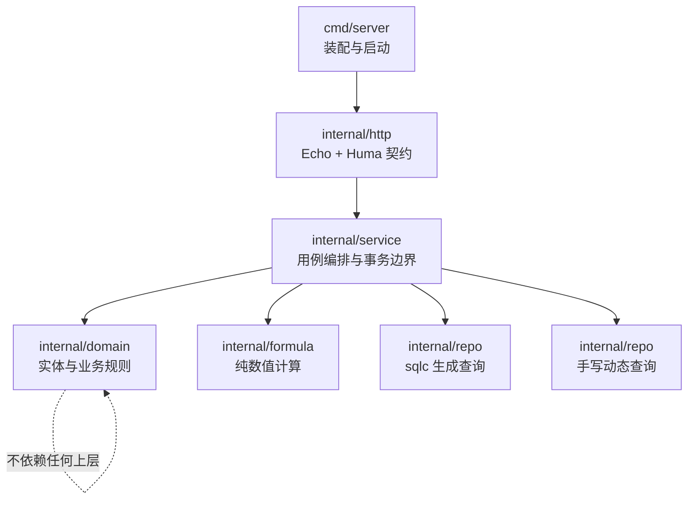
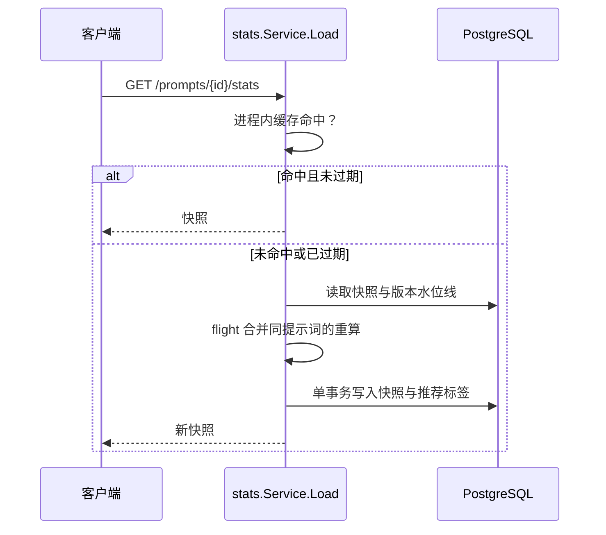

# 架构说明

本文按最终实现描述系统结构。完整实施方案见 `开发方案.md` §2，本文件补充实现完成后的实际形态与偏差说明。

## 分层结构



依赖方向单向向下。`domain` 与 `formula` 不做 I/O：前者不依赖数据库，后者连配置都不读（参数由调用方传入）。

## 后端包职责

| 包 | 职责 | 不做什么 |
|---|---|---|
| `internal/http` | 路由注册、参数绑定、错误模型、限流、中间件 | 不含业务规则，不直接写 SQL |
| `internal/service` | 用例编排、事务边界、跨实体协调 | 不含 HTTP 概念 |
| `internal/domain` | 实体行为、可见性判定、权限矩阵 | 不做 I/O |
| `internal/formula` | 贝叶斯校准、区分度、置信度、Bootstrap | 不做 I/O，不读配置 |
| `internal/repo` | sqlc 生成代码、手写动态查询、事务封装 | 不含业务规则 |
| `internal/config` | 环境变量加载与 `config` 表带缓存读取 | 不含业务默认值以外的逻辑 |
| `internal/security` | bcrypt、JWT、API Token、AES-256-GCM 密钥封装 | 不感知具体业务 |
| `internal/oplog` | 操作日志写入 | 只写不改不删 |
| `internal/mail` `internal/notify` `internal/metrics` | 邮件、站内通知、Prometheus 指标 | 横切能力 |
| `internal/platform` | 连接池、日志、迁移 runner、集成测试环境 | 不与业务耦合 |
| `internal/oauth` `internal/modelsdev` `internal/apperr` | 第三方接入与错误码表 | 外部依赖适配 |

## 三条结构性约束

### 可见性判定只有一处实现

需求禁止普通用户使用高风险类别，并要求开发者专属内容对普通用户与游客完全透明。这两条规则以 `domain.Viewer` 为唯一出口：

```go
type Viewer struct {
    UserID   int64
    Role     Role
    Logged   bool
    Writable bool
}

func (v Viewer) CanView(o Viewable) bool      // 单条判定
func (v Viewer) ListScope() (string, []any)   // 列表判定，生成 SQL 谓词
func (v Viewer) AuthorizeCategory(categoryIsHighRisk bool, visibility Visibility) error
```

`Viewable` 由提示词、题库、题库题目、收藏夹条目实现。全部读取路径——详情页、公开列表、收藏夹条目、题库题目、Markdown 导出——都调用它。校验命令：

```sh
grep -rn "is_high_risk" backend/internal/ --include="*.go"
```

业务判定处只应命中 `domain/`。

### 写路由必须登记限流

`api.Register` 在启动阶段校验：写方法未声明规则、或声明的规则不在集中声明表中，直接 panic。这条约束使「漏挂限流」无法进入运行期。

限流规则集中在 `internal/http/ratelimit.go` 的 `defaultRules` 表中，测试 `TestRateLimitRulesCoverWrites` 逐条核对。

### 高风险内容访问留痕

`prompt.Service.Get` 是内容访问的唯一入口：读取到高风险类别提示词时，无论授予还是拒绝都写入 `sensitive_content_access` 审计日志（G-12）。只做可见性闸门、不读内容的调用方（如评分列表）改用 `Visible`，避免同一页面访问产生多条记录。

## 统计计算与缓存

统计由 `internal/service/stats` 编排，数值计算全部委托 `internal/formula` 的纯函数，使需求给出的两个算例可以在脱离数据库的单元测试里逐条复现。



缓存取值：TTL 由配置项 `stats_cache_ttl_seconds` 决定（默认 60 秒，技术可行性报告 §3.1），容量上限 10000 条，达上限时淘汰一条随机条目。评分写入、提示词修改与重大修改主动作废对应条目，TTL 只用于兜底进程重启后遗留的条目。

## 事务与并发

| 场景 | 机制 |
|---|---|
| 配额（私有提示词、收藏夹、题库容量） | 事务内 `SELECT ... FOR UPDATE` 或条件 UPDATE 后复查（C-21） |
| 评分唯一性 | 部分唯一索引 + `ON CONFLICT DO NOTHING` |
| 评分单条修改上限 | 条件 UPDATE `WHERE edit_count < 上限` |
| 邀请码占用 | 事务内条件更新 |
| 统计快照写入 | 单个事务，快照两行、逐模型行、标签流转与审计日志要么全部生效要么全部不生效 |
| 统计重算与评分写入互斥 | `pg_advisory_xact_lock` 咨询锁 |

## 错误模型

全部错误响应为 `{error: {code, message}}`。错误码表在 `internal/apperr/codes.go`，是前后端契约的一部分：

- 服务层只构造 `apperr.Error`，HTTP 状态码由码表映射。
- 接口层 `Translate` 统一转换，业务代码不感知响应形状。
- 前端按 `error.<code>` 给出本地化文案；`frontend/src/i18n/errors.spec.ts` 读取后端码表逐条核对覆盖完整（中英双向：缺码与多余码都失败）。

## 前端结构

| 路径 | 内容 |
|---|---|
| `src/api/` | 接口调用封装。`client.ts` 负责统一前缀、错误信封解析、CSRF 双提交与 401 语义 |
| `src/views/` | 页面组件；`views/admin/` 为后台 11 个模块，按需加载 |
| `src/components/` | 顶栏、页脚、评论、举报、确认对话框等共享组件 |
| `src/stores/` | Pinia：登录态、偏好（语言与主题）、通知未读数 |
| `src/i18n/` | zh 为基准语言包，en 受其推导出的类型约束；`keys.spec.ts` 校验键一一对应 |
| `src/styles/tokens.css` | `--pb-*` 设计令牌，组件只引用变量 |

打包部署时前端构建产物经 `backend/internal/web`（`embedweb` 构建标签）内嵌进后端二进制，接口层注册兜底路由服务：未命中文件的路径回落 `index.html`（SPA 路由），`/assets/` 下带哈希的资源长缓存；`STATIC_DIR` 指向磁盘目录时优先服务磁盘。常规构建与测试不携带该标签，静态路由不注册，前端由 Vite 开发服务器服务。

路由守卫在进入受保护页面前解析登录态；管理后台再加一道身份判定，非管理员跳回首页。后端按 admin 中间件独立拦截，前端守卫只避免把无权用户带进空页面。

## 与方案的偏差

方案指 `开发方案.md` 与 `技术可行性报告.md` 的选型章节；两者保留为设计依据，本节记录与最终实现不一致之处。

| 项 | 方案原文 | 实际实现 | 原因 |
|---|---|---|---|
| 统计缓存 TTL | 可行性报告 §3.1：TTL 60 s（可配置），容量上限 10000 条 | 配置项 `stats_cache_ttl_seconds`，默认 60 秒；容量上限 10000 条，达上限随机淘汰 | 补齐可配置要求，实现与指标一一对应 |
| 集成测试环境 | 可行性报告 §4.1 选型 testcontainers-go（起真实 PostgreSQL 容器） | `platform/pgtest` 直接使用 `TEST_DATABASE_URL` 指向的本机 PostgreSQL，用例各自建库销毁 | 本机 PostgreSQL 实例即提供与生产一致的真实环境，无需容器运行时 |
| 文件上传大小 | 请求体上限 1 MB | 请求体 1 MB，`.md` 导入另有 512 KB 上限 | 与前端选择文件时的即时校验同源（`prompt.ImportLimit`） |
| 隐私政策与条款 | 静态页面，链接置于页脚 | 由 `/privacy` 与 `/terms` 两个路由渲染同一视图，文案随语言切换（G-10） | 双语要求下静态文件无法随界面语言切换 |
| 前端静态托管 | 「Nginx 提供静态资源与反向代理」（开发方案 §8.1） | 构建产物内嵌后端二进制由后端服务，Nginx 仅做 HTTPS 终结与反向代理（可选） | 单机部署无需 Nginx；`STATIC_DIR` 保留磁盘目录模式 |