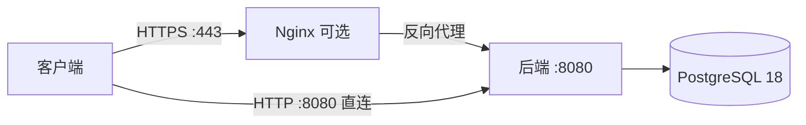

# 部署手册

按开发方案 §8 细化为可执行命令。目标环境：Ubuntu 22.04 单实例，2 核 4G。

## 组件与拓扑



前端构建产物内嵌在后端二进制中，由后端直接服务（SPA 路由回落与资源缓存头由后端处理）。单机场景可跳过 Nginx 直接访问 `http://主机:8080`；公网暴露与 HTTPS 终结用 Nginx（见第七节）。后端监听 `:8080`（全部网卡），经 Nginx 反代的形态可用防火墙把 8080 限制在回环。

## 一、准备系统

```sh
sudo apt update
sudo apt install -y curl git build-essential nginx

# PostgreSQL 18（PGDG 官方仓库）
sudo install -d /usr/share/postgresql-common/pgdg
sudo curl -o /usr/share/postgresql-common/pgdg/apt.postgresql.org.asc \
    https://www.postgresql.org/media/keys/ACCC4CF8.asc
echo "deb [signed-by=/usr/share/postgresql-common/pgdg/apt.postgresql.org.asc] \
http://apt.postgresql.org/pub/repos/apt jammy-pgdg main" | sudo tee /etc/apt/sources.list.d/pgdg.list
sudo apt update
sudo apt install -y postgresql-18

# Go 1.27 与 Node 22.12 以上
# （按发行版文档安装后核对版本）
go version
node --version
```

## 二、数据库

```sh
sudo -u postgres psql -c "CREATE ROLE promptbench LOGIN PASSWORD '换成强口令'"
sudo -u postgres psql -c "CREATE DATABASE prompt_benchmark OWNER promptbench"
```

迁移不手工执行：后端启动时按文件名顺序幂等应用，已应用的迁移校验 sha256。

## 三、构建

```sh
git clone <仓库地址> /opt/prompt-benchmark
cd /opt/prompt-benchmark

# 一键打包：构建前端、内嵌进后端、编译单文件二进制
deploy/pb.sh build
# 产物：dist/prompt-benchmark
```

打包需要 Go 1.27+、Node 22.12+ 与 pnpm（首次需在 `frontend/` 执行 `pnpm install --frozen-lockfile`）；运行产物只需 PostgreSQL，不依赖 Node。

## 四、环境变量

```sh
sudo mkdir -p /etc/prompt-benchmark
sudo tee /etc/prompt-benchmark/env >/dev/null <<'EOF'
PORT=8080
DB_HOST=127.0.0.1
DB_PORT=5432
DB_NAME=prompt_benchmark
DB_USER=promptbench
DB_PASSWORD=换成第二节设置的口令
DB_SSLMODE=disable

JWT_SECRET=用 openssl rand -hex 32 生成
CONFIG_SECRET=用 openssl rand -hex 32 生成
ADMIN_INIT_EMAIL=admin@example.com
ADMIN_INIT_PASSWORD=首次启动用的强口令，创建后立即在个人中心修改

SMTP_HOST=smtp.example.com
SMTP_PORT=587
SMTP_USER=noreply@example.com
SMTP_PASSWORD=邮件服务口令
SMTP_FROM=noreply@example.com

PUBLIC_BASE_URL=https://prompt-benchmark.example.com
CORS_ALLOW_ORIGINS=https://prompt-benchmark.example.com
COOKIE_SECURE=true

TRUSTED_PROXIES=127.0.0.1
LOG_LEVEL=info
EOF
sudo chmod 600 /etc/prompt-benchmark/env
```

| 变量 | 说明 |
|---|---|
| `JWT_SECRET` | 会话令牌签名密钥，32 字节十六进制；更换会使全部既有会话失效 |
| `CONFIG_SECRET` | 密钥类配置项的加密主密钥；未配置时后台拒绝保存密钥类配置 |
| `ADMIN_INIT_PASSWORD` | 首次启动创建初始管理员；未设置则跳过创建，不生成默认口令 |
| `COOKIE_SECURE` | 生产置 `true`，会话与 CSRF Cookie 仅经 HTTPS 传输 |
| `TRUSTED_PROXIES` | Nginx 反代地址。仅此时采信 `X-Forwarded-For`，防止伪造来源地址绕过登录限流 |
| `GITHUB_CLIENT_ID` / `GITHUB_CLIENT_SECRET` | 未配置时 OAuth 返回 503，其余功能不受影响 |
| `STATIC_DIR` | 留空时服务内嵌前端产物（默认）；设置时服务该磁盘目录，供本地调试 |

## 五、单机直接运行（无需 Nginx）

不装 systemd 单元与 Nginx 的最小形态，由控制脚本管理进程：

```sh
cd /opt/prompt-benchmark
cp backend/.env.example deploy/pb.env   # 填入数据库口令、密钥、邮件等
deploy/pb.sh start                      # 后台启动，健康检查通过才返回
deploy/pb.sh status
curl -s http://127.0.0.1:8080/api/v1/health
curl -sI http://127.0.0.1:8080/ | head -3
```

日常操作：

| 命令 | 作用 |
|---|---|
| `deploy/pb.sh start [环境文件]` | 后台启动（默认读 `deploy/pb.env`；可用 `PB_ENV_FILE` 覆盖） |
| `deploy/pb.sh stop` | 停止：先发 SIGTERM 等 10 秒，超时强制终止 |
| `deploy/pb.sh restart` | 停止后重新启动 |
| `deploy/pb.sh status` | 运行状态与健康检查（健康时退出码 0） |
| `deploy/pb.sh logs [行数]` | 查看 `dist/pb.log` 尾部 |

该形态直接监听 8080 全部网卡；需要开机自启、日志轮转或 HTTPS 时采用第六、七节的 systemd 与 Nginx。

## 六、systemd（生产托管）

```sh
sudo tee /etc/systemd/system/prompt-benchmark.service >/dev/null <<'EOF'
[Unit]
Description=Prompt Benchmark 后端
After=network.target postgresql.service

[Service]
Type=simple
User=www-data
WorkingDirectory=/opt/prompt-benchmark
EnvironmentFile=/etc/prompt-benchmark/env
ExecStart=/opt/prompt-benchmark/dist/prompt-benchmark
Restart=on-failure
RestartSec=3

# 最小权限
NoNewPrivileges=true
PrivateTmp=true
ProtectSystem=strict
ProtectHome=true
ReadWritePaths=/var/backups/prompt-benchmark

[Install]
WantedBy=multi-user.target
EOF

sudo systemctl daemon-reload
sudo systemctl enable --now prompt-benchmark
sudo systemctl status prompt-benchmark
curl -s http://127.0.0.1:8080/api/v1/health
```

收到 `SIGINT` / `SIGTERM` 时先取消后台任务，再优雅关闭 HTTP 服务（10 秒超时），最后关闭连接池。

## 七、Nginx（HTTPS 终结，可选）

前端资源已由后端服务，Nginx 只做 TLS 终结与反向代理：

```sh
sudo tee /etc/nginx/sites-available/prompt-benchmark >/dev/null <<'EOF'
server {
    listen 80;
    server_name prompt-benchmark.example.com;
    return 301 https://$host$request_uri;
}

server {
    listen 443 ssl http2;
    server_name prompt-benchmark.example.com;

    ssl_certificate     /etc/letsencrypt/live/prompt-benchmark.example.com/fullchain.pem;
    ssl_certificate_key /etc/letsencrypt/live/prompt-benchmark.example.com/privkey.pem;

    gzip on;
    gzip_proxied any;
    gzip_types text/css application/javascript application/json image/svg+xml;
    gzip_min_length 1024;

    # 全部流量反向代理到后端：接口、页面与静态资源统一由后端服务
    location / {
        proxy_pass http://127.0.0.1:8080;
        proxy_set_header Host $host;
        proxy_set_header X-Real-IP $remote_addr;
        proxy_set_header X-Forwarded-For $proxy_add_x_forwarded_for;
        proxy_set_header X-Forwarded-Proto $scheme;
        proxy_read_timeout 60s;
    }

    # 指标端点不进公网
    location /api/v1/metrics {
        deny all;
    }
}
EOF

sudo ln -sf /etc/nginx/sites-available/prompt-benchmark /etc/nginx/sites-enabled/
sudo nginx -t
sudo systemctl reload nginx
```

安全响应头由后端中间件统一设置，Nginx 不重复添加。

证书用 certbot 申请：

```sh
sudo apt install -y certbot python3-certbot-nginx
sudo certbot --nginx -d prompt-benchmark.example.com
```

Nginx 形态下 `PORT=8080` 且建议用防火墙限制 8080 只对回环开放；`TRUSTED_PROXIES=127.0.0.1` 使后端只采信 Nginx 转发的来源地址。

## 八、备份

`deploy/backup.sh` 每日逻辑备份并保留 7 天（G-01）：

```sh
sudo mkdir -p /var/backups/prompt-benchmark
sudo crontab -e
# 加入：
30 3 * * * DB_NAME=prompt_benchmark DB_USER=promptbench DB_PASSWORD=口令 \
  /opt/prompt-benchmark/deploy/backup.sh >> /var/log/pb-backup.log 2>&1
```

恢复：

```sh
sudo -u postgres psql -c 'CREATE DATABASE restore_target OWNER promptbench'
PGPASSWORD=口令 pg_restore --host=127.0.0.1 --username=promptbench \
    --dbname=restore_target --no-owner /var/backups/prompt-benchmark/prompt_benchmark-最新.dump
```

执行任何逆向脚本前必须先备份（开发方案 §8.4）。

## 九、监控与日志

| 项 | 做法 |
|---|---|
| 健康检查 | `GET /api/v1/health`，数据库不可达时返回 503 |
| 指标 | Prometheus 抓取 `http://127.0.0.1:8080/api/v1/metrics`（仅回环可达） |
| 应用日志 | journald；`journalctl -u prompt-benchmark --since '1 hour ago'` |
| 审计日志 | `operation_logs` 表，只增不改不删，不清理 |

## 十、升级

```sh
cd /opt/prompt-benchmark
git pull
deploy/pb.sh build
sudo systemctl restart prompt-benchmark   # systemd 形态
# 单机形态：deploy/pb.sh restart
```

迁移随启动幂等应用。回滚：换回上一版本二进制并重启；需要回退 schema 时按版本号逆序执行 `backend/migrations/down/` 脚本（先备份）。

回退注意事项：

- `down/004` 还原操作日志的动作白名单，库中若已有新的审计动作会失败，需先删除这两类日志行。
- `down/002` 删除全部表；`down/003` 删除种子数据，存在外键引用时失败，需先清理业务数据。

## 十一、部署自检

```sh
curl -s https://prompt-benchmark.example.com/api/v1/health
curl -sI https://prompt-benchmark.example.com/ | head -5
curl -s https://prompt-benchmark.example.com/api/v1/openapi.json | head -c 200
```

核对项：

- 健康检查返回 `{"status":"ok"}`。
- 首页返回前端产物（`Content-Type: text/html`）。
- `COOKIE_SECURE=true` 时，HTTP 访问拿不到会话 Cookie。
- `/api/v1/metrics` 从公网不可达。
- 初始管理员可登录并在个人中心修改口令。