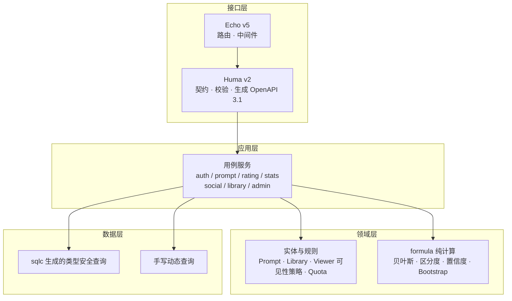
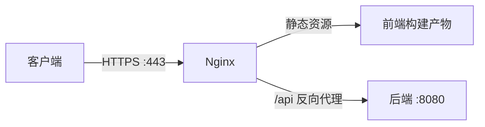

# Prompt Benchmark 开发方案

> **交付说明**
> 本文为接手本产品的开发团队提供完整的实施方案：架构设计、数据模型、接口契约、阶段计划、验收标准。
> 本文**自包含**：除产品需求文档（`需求.md`）外不依赖任何其他文件；与 `技术可行性报告.md` 互为配套，按需要交叉引用。

---

## 一、方案总览

### 1.1 技术组合

| 层 | 选型 |
|---|---|
| 语言 | Go 1.27 |
| HTTP 框架 | Echo v5.4.0 |
| 契约与校验 | Huma v2.39.1（挂载于 Echo） |
| 数据访问 | sqlc v1.31.1 + pgx v5.11.0 |
| 数据库 | PostgreSQL 18（PGDG 官方仓库安装，不使用容器） |
| 依赖注入 | 手写构造注入 |
| 前端 | Vue 3.5 + Vite 8 + TypeScript 6.0 + vue-router 5 + Element Plus 2.14 + Pinia 4 + TanStack Query |
| 集成测试 | `go test` + 本机 PostgreSQL（`TEST_DATABASE_URL` 指向可建库的维护库，用例各自建库销毁） |
| 端到端测试 | Playwright 1.64.0（Chrome、Edge、Firefox、WebKit 四浏览器） |
| 部署 | systemd + Nginx，单实例 |
| 环境前提 | Go 1.27；Node 22.12 以上（Vitest 5 的 `engines.node` 为 `^22.12.0 \|\| ^24 \|\| >=26`，与 Vite 8 的交集为 22.12+） |

选型论证见 `技术可行性报告.md` §4。

### 1.2 开发方法

**增量式交付，不用瀑布式。** 11 个后台模块、5 类角色、约 145 个端点，一次做完再验收不可行——中途没有任何可判断正确性的依据。

每个阶段交付一组**端到端可用**的功能（从数据库到界面的完整链路），阶段结束即形成可运行、可验收的产物。

每个阶段的固定工序：

```
规格确认 → 数据模型 → 后端实现 → 后端测试 → 前端实现 → 前端测试 → 端到端验收 → 门禁
```

不允许跳工序。「后端测试」与「端到端验收」尤其不可省略。

### 1.3 阶段划分

| 阶段 | 主题 | 依赖 |
|---|---|---|
| 0 | 工程骨架 | 无 |
| 1 | 认证与账户 | 阶段 0 |
| 2 | 提示词与评分 | 阶段 1 |
| 3 | 统计与推荐标签 | 阶段 2 |
| 4 | 社交与协作 | 阶段 2 |
| 5 | 私有题库 | 阶段 2 |
| 6 | 管理后台 | 阶段 3、4、5 |
| 7 | 加固与验收 | 阶段 6 |

顺序由依赖关系决定：统计依赖评分数据；收藏夹与题库依赖提示词；回收站依赖上述对象；后台依赖全部业务对象；端到端测试依赖前端界面。

阶段 4 与阶段 5 均只依赖阶段 2，彼此无接口与数据依赖，两者可并行推进。阶段 6 需要阶段 3、4、5 全部完成。

---

## 二、目标架构

### 2.1 分层



依赖方向单向向下，领域层不依赖任何上层。

### 2.2 目录结构

**backend/**

| 路径 | 说明 |
|---|---|
| `cmd/server/main.go` | 装配与启动 |
| `cmd/loadtest/main.go` | 压测工具（人工使用，不进 CI） |
| `migrations/*.sql` | 001 起按序编号，启动时幂等应用 |
| `migrations/down/` | 逆向脚本 |
| `db/schema.sql` | sqlc 输入：完整建表脚本 |
| `db/query/*.sql` | sqlc 输入：命名查询 |
| `internal/domain/` | 实体与规则，不依赖上层（prompt / library / question / viewer / quota） |
| `internal/formula/` | 纯计算，零依赖、无 I/O |
| `internal/service/` | 用例编排与事务边界（auth / prompt / rating / stats / social / library / admin） |
| `internal/http/` | Echo handler + Huma 契约注册 |
| `internal/repo/` | sqlc 生成代码 + 手写动态查询 |
| `internal/config/ security/ mail/ notify/ oplog/ metrics/` | 横切包 |
| `internal/platform/` | 连接池、迁移 runner、日志 |

**frontend/src/**

| 路径 | 说明 |
|---|---|
| `api/` | 手写接口封装：`client.ts` 统一前缀、错误信封与 CSRF 双提交，各域端点方法 |
| `views/ components/ stores/ composables/` | 视图与状态 |
| `i18n/` | zh / en，键须一一对应 |
| `styles/` | `--pb-*` 设计令牌 |

### 2.3 层职责边界

| 层 | 职责 | 明确不做 |
|---|---|---|
| `http` | 绑定、校验、调用服务、序列化响应 | 不含业务规则，不直接写 SQL |
| `service` | 用例编排、事务边界、跨实体协调 | 不含 HTTP 概念 |
| `domain` | 实体行为、业务规则、权限判定 | 不做 I/O，不依赖数据库 |
| `formula` | 纯数值计算 | 不做 I/O，不读配置（参数由调用方传入） |
| `repo` | 数据存取 | 不含业务规则 |

---

## 三、关键设计

### 3.1 可见性规则收敛到唯一实现

**这是本方案最重要的结构性设计。**

需求 §8.7 禁止普通用户选择高风险类别，需求 §8.4 要求开发者专属内容对普通用户与游客完全透明。这两条规则如果分散实现在多处（详情页判定、列表 SQL、分类解析、收藏夹复查、题库查询……），任何一处遗漏都会造成越权或信息泄漏。

新设计只有一个实现：

```go
// internal/domain/viewer.go —— 全系统唯一的可见性判定
type Viewer struct {
    ID   int64
    Role string
}

// CanView 单条对象判定
func (v Viewer) CanView(o Viewable) bool

// ListScope 列表判定，返回 SQL 片段与参数
func (v Viewer) ListScope() (string, []any)
```

`Viewable` 接口由 `Prompt`、`Library`、`Question`、`FavoriteItem` 等实体实现。

**强制约束**：

- 单条判定与列表判定从同一组谓词派生，不存在第二份实现
- 全部读取路径——详情页、列表、收藏夹条目、题库题目、导出——一律调用它
- 创建与更新路径共用同一套权限校验函数

**验收方式**：`grep -rn "is_high_risk\|visibility == \"developer\"" internal/ --include="*.go"` 在业务判定处只应命中 `domain/viewer.go`。

### 3.2 契约由代码生成

Huma v2 从 Go 类型与 struct tag 反向生成 OpenAPI 3.1：

```go
type CreateRatingRequest struct {
    PromptID int64 `json:"prompt_id" required:"true"`
    ModelID  int64 `json:"model_id"  required:"true"`
    Score    int   `json:"score" required:"true" minimum:"1" maximum:"5"
                    doc:"1-5 锚定评分"`
}
```

由此自动得到三样东西：

1. 服务端输入校验（JSON Schema，任何路径都无需重复手写）
2. OpenAPI 3.1 规范文档
3. 前端 TypeScript 类型定义（由规范生成）

**错误格式适配**：Huma 默认输出 RFC 9457 的 `application/problem+json`，而 C-41 要求 `{error:{code,message}}`。适配机制为覆盖 Huma 导出的包级变量 `huma.NewError`——Huma 的全部内置错误构造函数（`Error404NotFound`、`Error422UnprocessableEntity` 等）均经由它构造错误，替换该变量即可整体改变错误模型；`huma.NewErrorWithContext` 默认委托给它，无需单独覆盖。需在**阶段 0 完成并验证**——它是所有端点错误响应的共同基础，留到后面改会影响全部接口。

另需注意：`humaecho` 适配器不经由 Echo 的 `HTTPErrorHandler` 写错误，而是直接通过 `ResponseWriter` 输出，因此错误形状完全由 Huma 侧决定，Echo 侧无需额外配置。

### 3.3 校验分两层，不可互相替代

| 层 | 管什么 | 实现 |
|---|---|---|
| 形态校验 | 必填、长度、枚举、数值范围 | Huma struct tag 自动执行 |
| 业务规则校验 | 配额、权限、状态流转、类别角色限制 | 领域层实体与策略函数 |

形态校验由框架保证不可能漏；业务规则由实体自身保证。**不得把权限校验塞进形态校验的 tag**——那会让规则重新变得分散。

### 3.4 时间口径统一

遵循 C-03、C-04：

- 边界时刻**只在应用层计算一次**：`time.Now().UTC().Truncate(24h)` 加偏移
- 作为参数传入 SQL
- **SQL 中禁止出现 `date_trunc` 与任何依赖会话时区的表达式**

可用 `grep` 验证：`db/query/*.sql` 与 `internal/repo/` 中不得出现 `date_trunc`。

### 3.5 并发一致性

统一为「事务内锁定 → 计数 → 判定 → 写入」：

| 场景 | 机制 |
|---|---|
| 配额（私有提示词、收藏夹、题库、容量） | 事务内 `SELECT ... FOR UPDATE` 或条件 UPDATE 后复查 |
| 评分唯一性 | 部分唯一索引 + `ON CONFLICT DO NOTHING` |
| 评分单条修改次数上限 | 条件 UPDATE `WHERE edit_count < 上限` |
| 邀请码占用 | 事务内条件更新 |
| 统计快照写入 | 单个事务，消除半写状态 |

### 3.6 前端登录态探测

这是需求未提及但必须处理的一点。若响应拦截器对所有 401 无条件跳转登录页，而首次导航时会发一次登录态探测请求，则游客必然收到 401 并被弹回登录页——游客将无法浏览任何内容。

正确处理：

- 登录态探测请求显式标记 `silent: true`
- 拦截器中 401 且 `silent` 时不跳转，仅置为游客态
- 真正需要登录的操作触发 401 时才跳转，并带 `redirect` 参数
- 端到端测试覆盖游客路径作为回归防护

---

## 四、数据模型

### 4.1 表清单

约 39 张表，按域分组：

| 域 | 表 |
|---|---|
| 账户 | `users` `email_verifications` `oauth_accounts` `api_tokens` `invite_codes` `invite_code_usages` |
| 提示词 | `prompts` `prompt_versions` `prompt_version_ratings` `tags` `prompt_tags` `ratings` `rating_change_logs` `comments` `comment_likes` `reports` |
| 统计 | `prompt_stats` `prompt_model_stats` `recommend_tags` |
| 字典与模型 | `categories` `abilities` `difficulties` `models` `model_snapshots` `model_import_logs` |
| 社交 | `favorites` `favorite_items` `libraries` `library_members` `library_questions` `library_question_tags` `library_question_revisions` `follows` |
| 治理 | `recycle_bin` `transfer_logs` `operation_logs` `notifications` `announcements` `config` |

### 4.2 设计约定

- 命名 snake_case；枚举一律 TEXT + CHECK（不用原生 ENUM）；时间 `timestamptz DEFAULT now()`
- 软删除一律用 `deleted_at`，配合**部分唯一索引**保证活跃记录的唯一性
- 快照数据用 JSONB（评分快照、操作日志的 before/after、models.dev 原始字段）
- **无触发器、无存储过程**，全部业务规则在 Go 侧——业务逻辑放在应用代码里可读可测可版本管理

### 4.3 关键列与约束

| 表 | 关键约束 | 依据 |
|---|---|---|
| `prompts` | `visibility CHECK IN ('public','private','developer')`；`sensitive_level CHECK IN ('low','medium','high') DEFAULT 'low'`；`uploader_id`（前台展示）与 `original_uploader_id`（后台追溯）双列 | 需求 §8.1、§15.2；C-44 |
| `categories` | 增加 `is_high_risk BOOLEAN NOT NULL DEFAULT false` | C-19 |
| `ratings` | `score NOT NULL CHECK (score BETWEEN 1 AND 5)`；部分唯一索引 `(user_id, prompt_id, model_id) WHERE deleted_at IS NULL` | C-01 |
| `ratings` | `edit_count` 用于单条修改次数上限的条件 UPDATE | 需求 §3.4 |
| `reports` | `reason` 存英文枚举键，加 CHECK | C-31 |
| `users` | `status CHECK IN ('normal','unverified','banned')`；`token_version` 用于会话失效 | C-23、C-24 |
| `users` | `last_read_announcement_at` 公告已读水位线 | C-33 |
| `recycle_bin` | `object_type` 支持 5 类（初版启用 3 类） | C-30 |
| `prompt_model_stats` | `confidence_level CHECK IN ('high','medium','low')`，不允许空值 | 见阶段 3 专项回归 |
| `follows` | `CHECK (follower_id <> followee_id)`，防止自关注 |

### 4.4 索引设计要点

- 关键词检索依赖 `pg_trgm` 扩展（提示词标题、用户昵称、邮箱）
- 列表排序索引：`(created_at DESC)`、`(updated_at DESC)`、区分度排序走 `prompt_stats` 统计快照
- 部分唯一索引是并发安全的基础：评分唯一性、API Token 单活、当前版本唯一、题库题目去重

### 4.5 迁移机制

迁移脚本通过 `//go:embed` 打进二进制，启动时按文件名顺序幂等应用，每个文件一个事务，失败即中止启动，记录到 `schema_migrations` 表。

由此带来的运维特性：**升级时替换二进制后重启即完成迁移**，无需单独执行 migrate 命令。`down/` 目录提供逆向脚本供人工回滚，不被引擎执行。

> 启用关键词检索的迁移会创建 `pg_trgm` 扩展。该扩展自 PostgreSQL 13 起为受信扩展，库所有者可直接创建；若运行账号不是库所有者，需要提前由超级用户创建，否则启动会在迁移阶段失败。

---

## 五、接口契约

### 5.1 通用约定

| 项 | 约定 |
|---|---|
| 前缀 | `/api/v1` |
| 鉴权 | Cookie 会话（JWT）或 `Authorization: Bearer`（API Token）双通道 |
| CSRF | 写方法需要 `X-CSRF-Token` 与 Cookie 双提交；Bearer Token 通道豁免 |
| 分页 | `page`（从 1 起）、`page_size`（默认 20，上限 100） |
| 列表响应 | `{items, page, page_size, total}`；空列表为 `[]` |
| 错误响应 | `{error: {code, message}}`；HTTP 状态码由 code 映射 |
| 请求体 | 上限 1 MB |

### 5.2 鉴权级别

| 级别 | 含义 |
|---|---|
| G | 游客只读 |
| U | 登录用户 |
| U(作者) / U(成员) | 仅资源作者 / 仅题库成员 |
| D | 开发者用户（含普通全部权限） |
| A | 管理员（隐含满足 U 与 D 的全部条件） |

### 5.3 无权限对象统一 404

需求 §16.5 要求对无权限对象返回 **404 而非 403**，避免通过状态码差异探测对象存在性。此约定适用于全部对象类型，包括私有内容、开发者专属内容、高风险类别内容。

### 5.4 错误码表

| code | HTTP | 含义 |
|---|---|---|
| `not_found` | 404 | 不存在，或存在但对当前身份不可见 |
| `unauthorized` | 401 | 未登录或会话失效 |
| `forbidden` | 403 | 权限不足 |
| `banned` | 403 | 账户被封禁 |
| `invalid_csrf` | 403 | CSRF 头与 Cookie 不匹配 |
| `rate_limited` | 429 | 触发限流 |
| `bad_request` | 400 | 请求无法解析 |
| `validation_failed` | 422 | 字段校验不通过 |
| `invalid_state` | 422 | 当前状态不允许该操作 |
| `invalid_category` | 422 | 类别/能力/难度不合法 |
| `invalid_credentials` | 401 | 邮箱或密码错误 |
| `email_taken` | 409 | 邮箱已注册 |
| `email_not_verified` | 403 | 邮箱未验证 |
| `already_verified` | 409 | 重复验证 |
| `invalid_code` | 422 | 验证码错误或过期 |
| `invalid_invite` | 422 | 邀请码无效/已用完/已禁用 |
| `registration_closed` | 403 | 注册策略为关闭 |
| `email_not_allowed` | 422 | 邮箱后缀不在白名单 |
| `mail_send_failed` | 422 | 验证码信件发送失败 |
| `mail_error` | 422 | 后台测试邮件失败 |
| `oauth_not_configured` | 503 | 未配置 GitHub OAuth |
| `quota_exceeded` | 409 | 超出配额 |
| `rating_exists` | 409 | 已对该「提示词 × 模型」评过分 |
| `rating_edit_limit_exceeded` | 409 | 评分修改次数超限 |
| `rating_delete_limit_exceeded` | 409 | 评分删除次数超限 |
| `duplicate_model` | 409 | 模型重复 |
| `model_in_use` | 409 | 模型已被引用，不可删除 |
| `prompt_in_use` | 409 | 提示词已被题库引用，不可彻底删除 |
| `permission_denied` | 403 | 社交域权限不足 |
| `secret_unavailable` | 422 | 未配置主密钥，无法保存密钥类配置 |
| `bad_gateway` | 502 | models.dev 上游拉取失败 |
| `internal` | 500 | 未归类服务端错误 |
| `conflict` | 409 | 请求与当前资源状态冲突（框架产生） |
| `method_not_allowed` | 405 | 请求方法不被允许（框架产生） |
| `not_acceptable` | 406 | 无法满足请求的响应格式（框架产生） |
| `request_entity_too_large` | 413 | 请求体超出大小上限（框架产生） |
| `unsupported_media_type` | 415 | 不支持的请求体类型（框架产生） |
| `service_unavailable` | 503 | 服务暂不可用（框架产生） |
| `unprocessable_entity` | 422 | 请求无法处理（框架产生） |

后 7 个码只描述框架自身产生的响应，不由业务代码抛出，使「code 与 HTTP 状态码」的映射保持单值。

前端 i18n 键为 `error.<code>`，中英两份语言包须同时覆盖，由自动化测试校验键一一对应。

### 5.5 主要端点分组

| 组 | 端点范围 | 级别 |
|---|---|---|
| 认证 | 注册、邮箱验证与重发、登录、登出、GitHub OAuth、个人资料、改密、API Token | G / U |
| 提示词 | 列表、详情、创建、更新、删除、恢复、彻底删除、版本、Markdown 导入 | G / U(作者) / A |
| 评分 | 提交、修改、删除、我的评分 | U |
| 评论 | 列表、发表、回复、点赞、删除 | G（只读）/ U |
| 收藏夹 | CRUD、条目增删、他人公开收藏夹 | U / G（公开） |
| 关注 | 关注、取消关注、关注列表 | U |
| 题库 | CRUD、成员管理、题目 CRUD、标签、排序、回收站、导出 | U(所有者/成员) |
| 举报 | 提交、我的举报 | U |
| 通知 | 列表、未读数、标记已读、全部已读、删除 | U |
| 公告 | 列表、标记已读 | U |
| 字典 | 类别、能力、难度、标签、模型 | G |
| 后台 | 11 个模块的全部操作 | A |

完整清单由 Huma 生成的 OpenAPI 规范为准，不做手工维护。

### 5.6 前端视图清单

| 视图 | 路由 | 所属阶段 |
|---|---|---|
| 首页（公开列表：6 维筛选 + 3 排序 + 分页） | `/` | 2 |
| 提示词详情（评分、统计、评论、版本、复制、收藏、举报） | `/prompts/:id` | 2、3、4 |
| 提示词编辑（普通/重大修改） | `/prompts/:id/edit` | 2 |
| 上传（表单 + `.md` 导入） | `/upload` | 2 |
| 登录 / 注册 / 邮箱验证 / 口令找回 / GitHub 回调 | `/login` `/register` `/verify-email` `/reset-password` `/oauth/github/callback` | 1 |
| 个人中心（资料、口令、API Token、我的数据、注销账户） | `/me` | 1、2、7 |
| 我的收藏夹 / 他人公开收藏夹 | `/favorites` `/users/:userId/favorites` | 4 |
| 我的题库 / 题库详情（题目、成员、标签、导出、回收站） | `/libraries` `/libraries/:id` | 5 |
| 题库题目页（复制、修订记录） | `/library-questions/:id` | 5 |
| 通知中心（含公告分区） | `/notifications` | 4 |
| 隐私政策 / 用户条款 | `/privacy` `/terms` | 7 |
| 404 | 任意未匹配路由 | 0 |
| 管理后台（11 个模块 + 布局与侧边栏） | `/admin/*` | 6 |

视图总数 28 个。布局约定：所有页面共用顶栏（语言切换、主题切换、登录入口、通知铃铛）与页脚；管理后台共用侧边栏布局。移动端适配要求见需求 §21.2。

---

## 六、阶段计划

每个阶段列出交付内容、验收标准、测试重点。全部阶段的统一门禁见 §6.9。

### 6.1 阶段 0：工程骨架

**目标**：建立可运行的最小骨架，验证全部选型能协同工作。**本阶段不实现业务功能。**

**交付内容**

| 项 | 内容 |
|---|---|
| 项目结构 | 按 §2.2 建立目录；`go.mod` 声明 `go 1.27` |
| 数据库 | pgxpool 连接池；迁移 runner（`//go:embed`，启动时幂等应用）；种子数据（类别 13 项、能力维度 8 项、难度 3 档，见 C-44；config 表 27 键：C-45 的 26 项参数与统计缓存时长） |
| 配置 | 环境变量加载 + `config` 表 30s 缓存 |
| 中间件 | 恢复、请求日志、请求 ID、安全头、CORS、CSRF、限流 |
| 契约 | Huma 挂载，输出 OpenAPI 3.1；**覆盖 `huma.NewError` 使错误响应为 `{error:{code,message}}`** |
| 观测 | 健康检查端点、Prometheus 指标端点（仅回环可达） |
| 测试基础设施 | `platform/pgtest` 在维护库上按用例建库与销毁；前端 Vitest + Playwright 环境 |

**验收标准**

- [x] `go build ./...`、`go vet ./...`、`gofmt -l` 全绿
- [x] 迁移可从空库建出全部表，且每个迁移都有对应 down 脚本
- [x] 健康检查端点返回 200
- [x] Huma 输出的 OpenAPI 3.1 规范可在浏览器中打开
- [x] 错误响应为 `{error:{code,message}}`（验证钩子生效）
- [x] 未登记限流的写路由在启动时 panic（验证防护机制）
- [x] pgtest 能建库、跑迁移、执行查询、销毁
- [x] Node 版本满足 Vitest 5 与 Vite 8 的交集要求（22.12 以上），前端工程可构建并通过测试

**关键风险**：Huma 错误模型适配必须在本阶段完成。它是后续所有端点错误响应的共同基础。

### 6.2 阶段 1：认证与账户

**目标**：建立身份体系，这是全部权限判定的基础。

**交付内容**：邮箱密码注册与 SMTP 验证码；邮箱验证与未验证态权限限制（C-23）；登录登出与 JWT 会话；token version 机制（改密、封禁时失效旧会话）；邀请码注册与注册策略三态；GitHub OAuth（未验证邮箱走正常流程）；封禁解封与提示词转移至「沧海遗粟」；开发者身份授予与撤销；API Token 生成与撤销；密码找回。

**验收标准**

- [x] 游客可注册、验证、登录
- [x] 未验证账户可登录但不可评分/评论/上传（C-23）
- [x] 改密后旧会话立即失效
- [x] 封禁后旧会话立即失效且不能重新登录（C-24）
- [x] 封禁用户的提示词转移至「沧海遗粟」，公开状态不变，原上传者可追溯（C-25）
- [x] 关闭公开注册时邀请码注册仍可用（需求 §14.3）
- [x] GitHub 未验证邮箱的账户进入未验证态，不使用合成地址绕过（C-36）
- [x] API Token 仅展示一次，重新生成后旧 Token 失效

**测试重点**：认证是安全边界，测试密度应高于其他模块。并发注册同一邮箱（唯一索引）；并发占用邀请码（事务内条件更新，不重复消耗）；改密/封禁后旧会话行为（回归 C-24）；邮箱白名单边界；暴力登录防护（限流生效）。

### 6.3 阶段 2：提示词与评分

**目标**：建立平台的核心对象与核心行为。

**交付内容**：提示词创建（表单 + `.md` 导入）、编辑、删除；可见性三档与高风险类别约束；评分提交/修改/删除；评分修改删除限额（UTC 自然日）；版本机制与重大修改（含 7 步影响面）；首页 6 维筛选 + 3 种排序 + 分页；详情页展示；复制按钮。

**验收标准**

- [x] 普通用户不能选择高风险类别与开发者可见性——**创建与更新两条路径都拦截**
- [x] 高风险类别的提示词即使设为 public，对普通用户与游客也 404（C-20）
- [x] 评分量表 1–5 整数，空值被拒（C-01）
- [x] 评分修改第 4 次被拒；每日限额在 UTC 零点重置（C-03）
- [x] 重大修改后评分重置、历史归档、前台提示（C-27）
- [x] 首页 6 维筛选全部可用
- [x] 分页响应为 `{items, page, page_size, total}`，空列表为 `[]`（C-40）

**测试重点**：普通用户 PATCH 高风险类别 → 403（回归 C-20 的两条路径）；每日限额的 UTC 边界；并发提交同一「提示词 × 模型」评分；并发修改评分（单条上限不被突破）；重大修改后的重置与归档完整性。

### 6.4 阶段 3：统计与推荐标签

**目标**：实现平台的测量能力，这是公式正确性要求最高的部分。

**交付内容**：双窗口聚合；贝叶斯校准完成度；区分度计算与数据充分性闸门；完成度置信度；Bootstrap 区分度置信度（500 次）；统计快照落库与进程内缓存；推荐标签生成；标签 5 态流转；区分度排序（数据充足优先）。

**验收标准**

- [x] **需求两个算例复现：区分度 4.6 与 1.2**（需求 §4.5）
- [x] 数据不足时显示"数据不足，暂不计算区分度"（C-06）
- [x] 数据不足时不触发过时标签（需求 §4.3）
- [x] 区分度排序时数据充足的排在前面
- [x] **近 N 日无评分的模型不导致统计查询扫描失败**（专项回归，见下，读取与写入两条路径）
- [x] 统计查询中无未包 `COALESCE` 的 FILTER 聚合（`grep -n "FILTER (WHERE" db/query/*.sql`）
- [x] 统计快照写入在单事务内，无半写状态
- [x] Bootstrap 500 次单次计算 ≤ 200 ms
- [x] 区分度回升时待确认的过时标签转已忽略并记录日志（C-15）

**专项回归说明**：「模型有历史评分但近 N 日无评分」是一种必然出现的形态（平台运行超过 N 日后，老模型不再被复评）。该形态在两处触发失效：

其一，**读取路径**。sqlc 的空值分析器不读取 `AggFilter`，裸的 `count(*) FILTER (WHERE ...)` / `avg(...) FILTER (WHERE ...)` 生成非空类型，而该形态下 PostgreSQL 对这些表达式返回 NULL，扫描即以 `cannot scan NULL into *int64` 失败，详情页 500 且不自愈。统计查询一律按可行性报告 §4.4 的约定包 `COALESCE`。

其二，**写入路径**。若近窗口置信度取到零值空串写入带 CHECK 约束的列，统计写入会失败。

必须构造该数据形态，同时断言读取与写入两条路径均成功：`db/query/*.sql` 与 `internal/repo/` 中不得出现未包 `COALESCE` 的 FILTER 聚合，可用 `grep -n "FILTER (WHERE" db/query/*.sql` 逐条核对。

**测试重点**：纯函数层脱离数据库测试，覆盖两个算例与边界（n=0、n=1、极差 0、clamp 上下界、置信度各档门槛边界值）；端到端层构造真实评分验证 API 返回值与手算一致；Bootstrap 随机源可注入保证确定性。

### 6.5 阶段 4：社交与协作

**交付内容**：收藏夹 CRUD 与配额；关注；评论、回复、点赞、删除；举报（英文枚举键，仅登录用户）；站内通知中心（查看、标记已读、全部已读、删除、按类型筛选、未读计数）；公告（共享条目 + 水位线）；收藏夹条目逐条复查可见性。

**验收标准**

- [x] 举报提交成功（英文枚举键，回归 C-31）
- [x] 举报原因在英文界面下显示英文文案
- [x] 游客可查看公开收藏夹
- [x] 收藏夹中被改为私有或高风险的提示词不再展示
- [x] 通知中心 6 项能力全部可用
- [x] 公告撤回后立即从用户侧消失
- [x] 配额在并发下不被突破（C-21）

**测试重点**：举报英文枚举键端到端可用；并发创建收藏夹抢配额；收藏夹条目可见性复查。

### 6.6 阶段 5：私有题库

**交付内容**：题库 CRUD 与配额；成员管理（所有者/协作者）；权限划分（协作者可 11 项、不可 7 项）；引用题目与派生题目；题目标签、排序、回收站；Markdown 导出（14 项要素）；协作者删题的日志与通知。

**验收标准**

- [x] **协作者可读的引用题，若原提示词为开发者可见或高风险，协作者不可见**（专项回归，见下）
- [x] 协作者可删除任何题目，记录 6 项要素并通知所有者（C-34）
- [x] 所有者本人删除题目时不通知自己（需求 §10.6）
- [x] 派生题不占私有提示词额度，也不占题库容量（C-22）
- [x] 引用题跟随最新版本，派生题不受原提示词重大修改影响（C-28）
- [x] 导出内容含 14 项要素
- [x] 题库题目并发添加不超容量

**专项回归说明**：题库题目查询若只校验成员身份而不复查被引用提示词的可见性，普通用户协作者就能读到开发者专属内容的全文，导出接口同样泄漏。必须构造"所有者把开发者可见提示词加入题库并邀请普通用户协作"的场景，断言读取返回 404。

**测试重点**：上述越权读取场景；协作者与所有者权限边界逐条验证（11 项可 + 7 项不可）；并发添加题目；删除被引用的提示词（引用检查）。

### 6.7 阶段 6：管理后台

**交付内容**：11 个模块（C-42）——统计仪表盘（18 项指标）、提示词管理（含强制标记重大修改）、模型管理（含 models.dev 导入与重复处理）、用户管理、标签管理（含推荐标签批量处理）、举报管理、注册与邀请码管理、操作日志、公告管理、回收站管理、系统设置（含 SMTP 测试邮件）。

**验收标准**

- [x] 11 个模块全部可用
- [x] **后台列表全部有分页**（不留无翻页控件的截断列表）
- [x] 操作日志覆盖 18 类操作，且不可编辑不可删除（C-43）
- [x] 敏感配置项加密存储，未配主密钥时拒绝保存
- [x] 管理端枚举值在中文界面下显示中文
- [x] 强制标记重大修改可用
- [x] models.dev 导入的重复处理走二次确认
- [x] models.dev 导入按 `provider.name` / `models[id].*` 路径取值，缺失 `modalities` 的模型导入为空值而非报错（需求 §13.3）
- [x] 导入失败返回 502 `bad_gateway`，限流计数正常累加，错误经 i18n 键 `error.bad_gateway` 正确显示（连续失败时先触发 429 的行为符合预期）

**测试重点**：非管理员访问后台路由被拦截（前端守卫 + 后端中间件双重）；操作日志的完整性；配置项边界值（数值范围、枚举白名单）；破坏性操作的二次确认与引用检查。

### 6.8 阶段 7：加固与验收

**交付内容**：安全加固（`技术可行性报告.md` §3.3 全部项核查）；性能验证（按 `技术可行性报告.md` §3.1 指标压测）；端到端测试补全；中英双语键一一对应校验；移动端 375px 适配；无障碍（图标按钮可访问名称、键盘可达、对比度）；浏览器兼容性验证（G-06：最近两个大版本的 Chrome / Firefox / Safari / Edge）；敏感内容访问审计（G-12：高风险类别内容的每次访问写入审计日志）；缺口项 G-01 备份、G-08 数据导出、G-09 注销、G-10 隐私条款；全套技术文档。

**验收标准**

- [x] 全部性能指标达标
- [x] Playwright 覆盖游客浏览、注册登录、评分、评论、举报、收藏夹、题库协作、后台主要操作
- [x] 375px 窄屏全部路由无横向溢出
- [x] 中英双语键一一对应（自动化测试守底）
- [x] 四种浏览器各执行一轮 Playwright 全量用例通过
- [x] 高风险类别内容被普通用户访问时产生审计记录（G-12）
- [x] 文档与实现逐条核对一致

### 6.9 统一门禁

**每一阶段结束必须全部满足，否则不得进入下一阶段。**

| 门禁 | 判据 |
|---|---|
| 后端格式 | `gofmt -l ./cmd ./internal` 无输出 |
| 后端编译 | `go build ./...` 通过 |
| 后端检查 | `go vet ./...` 通过 |
| 后端测试 | `go test ./...` 全绿（`TEST_DATABASE_URL` 指向可建库的维护库，用例各自建库销毁） |
| 契约 | Huma 生成的 OpenAPI 无警告，且与实现一致 |
| 前端检查 | lint 0 warning / 0 error |
| 前端类型 | 无 TypeScript 编译错误 |
| 前端测试 | 单元测试全绿 |
| 前端构建 | 构建通过 |
| 端到端 | Playwright 全部用例通过 |
| 需求核对 | 本阶段对应需求条目逐条确认 |

---

## 七、测试策略

### 7.1 三层测试

| 层 | 工具 | 覆盖对象 |
|---|---|---|
| 纯函数 | `go test` | `formula` 包全部公式与边界 |
| 集成 | `go test` + 本机 PostgreSQL | `TEST_DATABASE_URL` 指向可建库的维护库，用例各自建库、跑真实迁移与查询后销毁 |
| 端到端 | Playwright | 关键用户路径，含全部游客路径 |

`formula` 包要求：零依赖、无 I/O、随机源可注入。这是整个系统测试最扎实的部分，也是平台可信度的根基，不应妥协。

### 7.2 缺陷修复纪律

发现缺陷时按顺序处理：

1. 先写一个能复现该缺陷的测试（此时测试应失败）
2. 修复实现
3. 测试通过
4. **检查同类结构在其他位置是否存在相同问题**

第 4 步是防止缺陷再生的关键。同类项目中「更新路径漏了创建路径的校验」「某处查询漏了可见性条件」都属于同一规则在多处重复实现、其中一处遗漏的产物——单点修补治标，结构收敛治本（见 §3.1）。

### 7.3 禁止的做法

- 禁止为通过测试而放宽断言或跳过用例
- 禁止用 mock 替代真实数据库来"解决"集成测试不稳定——不稳定应修根因
- 禁止同时改动需求裁决与代码实现；发现裁决有问题时，先更新裁决文档再改代码
- 禁止跳过测试直接提交业务代码

---

## 八、部署方案

### 8.1 部署形态

Ubuntu 22.04 单实例：PostgreSQL 18（PGDG 官方仓库） + systemd 托管后端 + Nginx 提供静态资源与反向代理。



Nginx 承担 gzip、静态资源长缓存、安全响应头。后端监听 `127.0.0.1:8080`，不直接暴露。

### 8.2 环境变量

| 变量 | 用途 | 备注 |
|---|---|---|
| `PORT` | 监听端口 | 默认 8080 |
| `DB_HOST` / `DB_PORT` / `DB_NAME` / `DB_USER` / `DB_PASSWORD` / `DB_SSLMODE` | 数据库连接 | 生产建议 `DB_SSLMODE=require` |
| `JWT_SECRET` | JWT 签名密钥 | 32 字节十六进制 |
| `CONFIG_SECRET` | 敏感配置项加密主密钥 | 未配置时拒绝保存密钥类配置 |
| `ADMIN_INIT_PASSWORD` | 初始管理员密码 | 首次启动创建后应立即修改 |
| `SMTP_HOST` 等 | 邮件配置 | 亦可在后台 `config` 表中配置，库配置优先 |
| `GITHUB_CLIENT_ID` / `GITHUB_CLIENT_SECRET` | GitHub OAuth | 未配置时 OAuth 返回 503 |
| `TRUSTED_PROXIES` | 受信反代 IP/CIDR | 仅此时采信 `X-Forwarded-For`，防止伪造 IP 绕过登录限流 |
| `STATIC_DIR` | 静态资源目录 | 生产由 Nginx 托管时可留空 |
| `LOG_LEVEL` | 日志级别 | debug/info/warn/error |

### 8.3 启动流程

```
加载环境变量 → 初始化数据库连接池 → 执行未应用的迁移（幂等）
→ 确保初始管理员存在（幂等）→ 注册路由与中间件
→ 启动后台任务（限流窗口清理、回收站到期清理）→ 监听端口
```

优雅关停：收到 SIGINT/SIGTERM → 先取消后台任务 → HTTP 服务优雅关闭（10 秒超时）→ 关闭数据库连接池。

### 8.4 运维要点

| 项 | 方案 |
|---|---|
| 备份（G-01） | 每日逻辑备份（`pg_dump`），保留 7 天；执行任何逆向脚本前必须先备份 |
| 升级 | 替换二进制后 `systemctl restart`，迁移自动应用 |
| 回滚 | 换回上一版本二进制；需要回退 schema 时按版本号逆序执行 `down/` 脚本（须先备份） |
| 监控（G-02） | Prometheus 抓取 `/api/v1/metrics`（仅回环可达）+ 健康检查端点 |
| 日志（G-07） | 应用日志轮转保留 30 天；审计日志不清理 |
| 定时清理 | 限流窗口清理与回收站到期清理由后端进程内定时任务执行；推荐标签在统计读取时按需重算 |

`down/` 脚本使用注意：`down/001` 删除全部表；`down/002` 删除种子数据，存在外键引用时会失败，需要先清理业务数据。

---

## 九、附录

### 9.1 需求裁决索引

46 项裁决（C-01 ~ C-46）与 20 项缺口补齐（G-01 ~ G-20）的完整内容、依据行号与理由见 `技术可行性报告.md` §2 与 §3。本文档各处引用裁决编号处可按图索骥。

### 9.2 核心公式索引

贝叶斯校准、区分度、置信度、Bootstrap、推荐标签触发条件的完整定义与两个验收算例见 `技术可行性报告.md` §7.1。

### 9.3 文档交付清单

以下文档已交付，与实现逐条核对一致：

| 文档 | 位置 |
|---|---|
| 需求追溯表（需求条目 → 实现位置 → 验收方式 的逐条映射） | `docs/需求追溯表.md` |
| API 文档（由 Huma 生成，不手工维护） | `/api/v1/openapi.json` 与 `/api/v1/docs` |
| 架构说明（按最终实现描述 §2 的结构） | `docs/架构说明.md` |
| 部署手册（按 §8 细化为可执行命令） | `docs/部署手册.md` |
| 开发与测试指南（构建、检查、测试、冒烟的完整命令） | `docs/开发与测试指南.md` |
