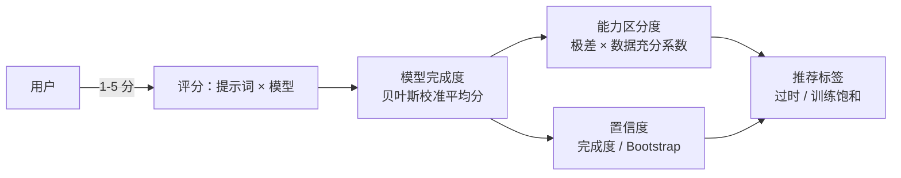

# Prompt Benchmark 技术可行性报告

> **交付说明**
> 本文面向接手本产品的开发团队，内容为技术可行性论证与开发实施建议。
> 本文**自包含**：除产品需求文档（`需求.md`）外不依赖任何其他文件；与 `开发方案.md` 互为配套，按需要交叉引用。
> 文中所有版本号、发布日期、验证结论均标注来源，可复核。调研与验证基准时间为 2026 年 10 月。
> 配套文档：`开发方案.md`（实施计划、架构与验收）。

---

## 一、项目理解

### 1.1 产品是什么

Prompt Benchmark 是**提示词能力边界评测平台**（需求 §1.1）。

它的产品定位有一个容易被误解的关键点：平台**不是提示词分享站**。它的价值不在于收集好用的提示词，而在于维护一批能够**测量模型能力边界**的测试型提示词——即能反映模型能力差异、能判断某个模型是否被针对训练或优化过的提示词（需求 §1.1）。

理解这一点决定了后续全部设计取向：平台的产出物是**测量结论**，不是内容社区。

### 1.2 核心业务模型

由一个核心对象与三个派生指标构成（需求 §1）：



| 指标 | 谁产生 | 含义 |
|---|---|---|
| 模型完成度 | 用户主观评分 | 某个模型在这条提示词上做到了几分 |
| 模型能力区分度 | 系统计算 | 这条提示词能否拉开不同模型的差距 |
| 置信度 | 系统计算 | 上述结论在统计上是否可信 |
| 推荐标签 | 系统生成 + 管理员确认 | 过时 / 训练饱和等生命周期判断 |

三条由此推出的设计原则：

1. **用户只评价完成情况，不评价提示词好坏**（需求 §3.1）。这是产品区别于评分站的根本。
2. **统计是派生数据**，可由评分重算，因此可以做缓存、做快照、做后台重算。
3. **数据不足时明确说不足**（需求 §4.3）。样本不够就显示"数据不足"，而非给出一个看似可信的数字。这是平台可信度的根基，任何"让数字看起来更好看"的优化都与之抵触。

### 1.3 用户角色

五类（需求 §2）：游客、普通用户、开发者用户、管理员、系统账户「沧海遗粟」。

开发者用户是平台的特殊群体：他们可以看到并上传「开发者专属内容」——即高风险、越狱、对抗类提示词（需求 §8.4）。这类内容对普通用户与游客**完全透明**：不可见、不可搜索、不可通过链接直接访问（需求 §2.3）。

系统账户「沧海遗粟」用于承接被封禁用户的提示词（需求 §2.5）。

### 1.4 功能范围

按需求文档，完整功能面包含：评分体系、区分度与置信度、版本与重大修改、提示词管理、收藏夹、私有题库与协作、回收站、评论举报通知、模型管理、注册登录与邀请码、用户封禁、开放 API、管理后台 11 个模块。

---

## 二、需求澄清：争议点的裁决

### 2.1 前情提要

本节给出 **46 项设计裁决**（C-01 ~ C-46）与 **20 项缺口补齐**（G-01 ~ G-20）。每项标注原始依据行号与裁决理由。这些裁决可被推翻，但推翻时必须同步修改本节——**本节是后续开发与验收的唯一取值依据**。

### 2.2 计算口径（C-01 ~ C-11）

| 编号 | 议题 | 裁决 | 理由与依据 |
|---|---|---|---|
| C-01 | 评分是否可空 | `score` 列 `NOT NULL`，整数，`CHECK (score BETWEEN 1 AND 5)` | 需求 §3.2 明确"无法判断或未测试不构成评分，不写入"；同节限定 1-5 整数锚定量表 |
| C-02 | 详情页展示哪个分数 | **同时展示**原始平均分与贝叶斯校准平均分 | §3.6 说展示原始分，§3.7 的展示清单又要求校准分；取并集，因为两者语义不同（原始反映观测，校准反映统计修正） |
| C-03 | 时间窗口的时区基准 | 近 N 日窗口以 **UTC 自然日**切分，含当天，边界为 UTC 当日 00:00:00；每日计数同为 UTC 自然日 | 需求未定义时区基准（G-19）。UTC 是唯一在跨国访问下给出一致结果的选项 |
| C-04 | 窗口边界在哪里计算 | **只在应用层**计算，作为参数传入 SQL；SQL 中禁止出现 `date_trunc` 与任何依赖会话时区的表达式 | 需求未定义。边界只在一处计算，可从结构上杜绝 SQL 会话时区漂移 |
| C-05 | "有效模型"的定义 | 该窗口内有效评分数 ≥ 每模型最低评分数阈值（默认 3）的模型 | §4.4 的"有效模型数"与 §4.3 的"每模型至少 3 条"应指同一判定，否则出现"模型数够但每个模型数据都不够"的矛盾态 |
| C-06 | 数据不足的文案 | 统一为「数据不足，暂不计算区分度」，数值位显示「—」 | §4.3 与 §4.6 给出两种文案，取前者，因为它说明了原因 |
| C-07 | 系数分母与门槛的关系 | §4.4 的分母 20 与 §4.3 的门槛 10 **保持独立**，互不推导 | 需求分别给出，是两个独立参数。强行统一会改变需求算例的结果值 |
| C-08 | Bootstrap 重复次数 | 固定 **500 次**，可配置项 `bootstrap_iterations` | §5.2 写"500 或 1000 次"未定稿。500 次在 2 核 4G 目标机上单次计算耗时可接受 |
| C-09 | 置信区间半宽算法 | 正态近似 `h = 1.96 * sd / sqrt(n)`，样本标准差用 n−1 分母 | §5.1 列出 `CI=95%` 与 `h` 但未定义算法。正态近似可复现且与 `h/1.0` 的归一化量纲一致 |
| C-10 | 极少样本时的处理 | `n < 2` 时标准差取 0，`h` 取 0；置信度第一项仍按 `min(1, n/20)` 正常计算 | 避免除零，并保证极少量样本时置信度由样本量项主导 |
| C-11 | 等级判定逻辑 | 维持"分数 + 两个硬门槛"的**与**关系。`confidence ≥ 0.75` 但 `n < 20` 判为低是预期行为 | §5.1 的"其他情况"字面即此含义。硬门槛的作用是防止小样本被高分公式抬上去 |

### 2.3 推荐标签生命周期（C-12 ~ C-16）

| 编号 | 议题 | 裁决 | 理由与依据 |
|---|---|---|---|
| C-12 | 重大修改后过时标签的终态 | → **待复核**（训练饱和标签同为待复核） | §6.4 说"失效"，§7.3 说"进入待复核"，冲突。取待复核：它保留管理员查看判定依据并重新决策的能力，符合 §6.3 列出的 8 项管理操作（含"查看推荐理由""查看触发时评分快照"） |
| C-13 | 标签初始态与流转 | 新建 → **待确认**；确认 → 已确认；忽略 → 已忽略；重大修改 → 待复核；待复核可再次确认或忽略 | §6.3 列出 5 态但未定义初始态与流转 |
| C-14 | 「已过期」态如何产生 | 标签对应提示词被删除或彻底删除时 → 已过期 | 需求列出该态但无触发规则 |
| C-15 | 区分度回升时的旧标签 | 已存在的待确认过时标签 → **已忽略**，记录审计日志 `discrimination_recovery`，不删除 | §6.1 要求不推荐过时，但已生成的待确认项若留着会永久占用管理端列表。转已忽略保留追溯能力 |
| C-16 | 两类标签的置信度口径 | 「过时」用**区分度置信度**；「训练饱和」用**该模型近 N 日完成度置信度**。不可混用 | §6.1 与 §6.2 字面不同且指标不同，按各自判定对象维持区分 |

### 2.4 权限与可见性（C-17 ~ C-20）

| 编号 | 议题 | 裁决 | 理由与依据 |
|---|---|---|---|
| C-17 | 管理员是否隐含开发者权限 | 是。`IsDeveloper()` 判定为 `role == developer \|\| role == admin` | 权限矩阵 §19 显示管理员在全部 16 项上均为"是"，含"上传开发者提示词""访问开发者 API" |
| C-18 | 私有提示词管理员是否可见 | **可见并可管理** | §8.3 只写"仅上传者本人可见"未提管理员；而 §8.4 对开发者可见内容明写管理员可见可管理。两者应一致，否则管理员无法执行 §17.2 要求的删除/恢复/彻底删除 |
| C-19 | 哪些类别是高风险 | 类别表增加布尔列 `is_high_risk`，由管理员逐项标记；默认将「越狱对抗」标记为高风险 | §8.7 要求限制高风险类别但未定义映射。做成可配置字段而非硬编码，让管理员随政策调整 |
| C-20 | 高风险类别的可见性 | 与 `developer` 可见性**同等处理**：即使设为 public，对普通用户与游客也一律 404（列表过滤 + 直链 404） | §8.4 要求开发者内容"不可见、不可搜索、不可链接访问"。若高风险类别可设 public 而对普通用户可见，等于绕过了 §8.7 |

**C-20 是本项目的关键安全裁决。** 需求在 §8.7 禁止普通用户选择高风险类别，但没有说明已经存在的高风险类别提示词如果被设为 public 该如何处理。若不做同等约束，普通用户可以通过"先用普通类别创建、再改成高风险类别"或与他人协作的方式绕过限制。

### 2.5 配额与并发（C-21 ~ C-22）

| 编号 | 议题 | 裁决 | 理由与依据 |
|---|---|---|---|
| C-21 | 配额的并发语义 | 判定必须在**事务内**完成，采用「锁定 → 计数 → 判定 → 写入」的串行化顺序，不得事务外计数后插入 | 需求未定义并发语义（G-20），而配额是安全边界 |
| C-22 | 派生题与回收站题是否占额度 | 派生题不计入私有提示词额度（§8.3 明文）**也不计入题库 150 题上限**；回收站中的题目**计入** 150 题 | 需求未说明 150 题是否含派生题与回收站题。派生题不占个人额度已有明文，按同一逻辑不占题库容量；回收站题仍占存储且可恢复，计入容量防止无限堆积 |

### 2.6 账户状态（C-23 ~ C-26）

| 编号 | 议题 | 裁决 | 理由与依据 |
|---|---|---|---|
| C-23 | 未验证账户态的行为 | 三态 `正常 / 未验证 / 封禁`。未验证态：可登录、可浏览、**不可**评分/评论/上传/创建收藏夹/创建题库/生成 Token。验证后转正常 | §14.3 要求所有注册验证邮箱，但完全未定义未验证态行为（最大缺口）。取"允许登录但限制写操作"：既不放任未验证邮箱产生内容，也不因邮件投递失败完全锁死用户 |
| C-24 | 封禁后的认证行为 | **不能登录**（返回 `banned`），且**已有会话立即失效**（提升 token version） | §15.1 写"不能登录，**或**登录后仅能查看封禁状态"，二选一未定稿。取"不能登录 + 会话失效"：这是唯一能真正执行 §15.1 七条限制的方案 |
| C-25 | 解封后归属 | 转移至「沧海遗粟」后**不**自动转回原用户。公开状态保持不变，评分/评论/收藏保留，后台可追溯原上传者 | §15.2 未定义解封后归属。转移已完成且期间可能产生新评分，回退会造成数据归属混乱 |
| C-26 | 封禁用户的历史评分 | **继续计入**统计 | 需求未说明。评分是对模型完成度的观测事实，剔除会改变其他用户看到的统计口径，与 §15.2"评分数据保留"一致 |

### 2.7 版本机制（C-27 ~ C-28）

| 编号 | 议题 | 裁决 | 理由与依据 |
|---|---|---|---|
| C-27 | 版本号进位规则 | 主版本 +1 时次版本**归零**（`v1.3` 重大修改后为 `v2.0`）；次版本进位无上限（`v1.9` 后为 `v1.10`） | §7.1 未定义进位规则，取最常见的语义化版本行为 |
| C-28 | 派生题的版本行为 | 引用题跟随最新版本（§7.4）；派生题独立存储、不受原提示词重大修改影响（§10.7）。派生题**不参与版本机制**，修改历史记录在题目修订表中 | 需求未定义派生题版本行为。派生题已是独立副本，引入版本号会造成"派生题 v1.0 对应原提示词 v2.0"的混淆 |

### 2.8 回收站（C-29 ~ C-30）

| 编号 | 议题 | 裁决 | 理由与依据 |
|---|---|---|---|
| C-29 | 14 天从何时起算 | 从**进入回收站的时刻**起算；恢复后再删除时重新起算 | §11.3 未定义起算点，取进入时刻，语义最直接 |
| C-30 | 初版与完整版的关系 | 保留完整版 5 类所需的**数据模型**设计（回收站表支持 5 类 object_type），但**只启用 3 类**的行为 | §11.1 定义完整版 5 类，§11.2 定义初版 3 类。表结构一次设计到位，后续启用无需迁移 |

### 2.9 举报与通知（C-31 ~ C-34）

| 编号 | 议题 | 裁决 | 理由与依据 |
|---|---|---|---|
| C-31 | 举报原因的存储形态 | API 层使用**英文枚举键**（`bad_content` / `illegal` / `porn` / `attack` / `privacy` / `spam` / `dangerous` / `other`），中文文案保留在前端语言包与展示层；数据库列存英文键 | §12.2 给的是中文枚举，但平台需要支持中英双语界面。存中文会让英文界面无法本地化，且与平台其余枚举（可见性、角色、回收站类型）的英文 slug 惯例不一致 |
| C-32 | 游客能否举报 | **仅限登录用户** | §12.2 只写"用户可以举报"未限定，但 §12.1 明确游客只能查看评论，且权限矩阵 §19 显示游客"举报：否" |
| C-33 | 公告分发机制 | **全员共享条目 + 每用户水位线**：公告只存一份，已读状态由用户表上的单个水位线时间戳标记 | 需求只说"公告通知"未定义分发机制。逐用户扇出会在发布时产生 N 倍写入，且撤回后残留通知。水位线模式同时解决这两点 |
| C-34 | 协作者删题的日志与通知 | 协作者删除须记录 6 项要素并通知所有者（§10.6）；所有者本人删除**不通知**（§10.6）。所有者删除同样记录完整日志与删除前快照 | 需求只在协作者条目下写了 6 项要求。取同样记录：审计日志应对称，否则后台日志不完整 |

### 2.10 注册与认证（C-35 ~ C-38）

| 编号 | 议题 | 裁决 | 理由与依据 |
|---|---|---|---|
| C-35 | 邮箱后缀限制的语义 | **白名单**：配置项为空表示不限制，非空则只允许列表内后缀 | §14.3 未说明黑白名单。白名单对有限开放社区更合适，且空值即放开，默认行为安全 |
| C-36 | GitHub OAuth 邮箱未验证时 | 账户置为 `未验证` 并走正常邮箱验证流程；**不使用合成邮箱地址绕过** | §14.3 要求所有注册均需要验证邮箱。合成地址会绕过该要求，且与邮箱白名单配置冲突 |
| C-37 | 关闭注册时的 GitHub | GitHub 授权**新用户注册**被拒；已绑定 GitHub 的**存量用户登录**不受影响 | 需求未说明。策略意图是控制新用户进入，不应影响存量用户登录 |
| C-38 | 邀请码耗尽后 | 不可再用（返回 `invalid_invite`）；管理员可随时禁用；已使用记录保留 | §14.5 定义字段但未定义耗尽行为 |

### 2.11 API 契约（C-39 ~ C-41）

| 编号 | 议题 | 裁决 | 理由与依据 |
|---|---|---|---|
| C-39 | 管理端 API 的组织 | 与业务 API 共用同一前缀 `/api/v1`，通过中间件区分鉴权级别，不单独设 `/admin` 前缀域 | 需求 §16.1 只定义两类 API，未定义管理端 API 域，而第 17 章要求大量后台能力。共用前缀避免两套鉴权体系 |
| C-40 | 分页契约 | 参数 `page`（从 1 起）与 `page_size`（默认 20，上限 100）；响应 `{items, page, page_size, total}`；空列表返回 `[]` 而非 `null` | §16.6 给出 `page`/`page_size`/`total` 线索，补齐默认值、上限与空列表形态 |
| C-41 | 错误响应契约 | 统一 `{error: {code, message}}`，`code` 为 snake_case 稳定标识符，`message` 为中文文案；HTTP 状态码由 code 映射；前端按 `error.<code>` 做 i18n 覆盖 | 需求 §16.5 只给一处 404 建议，无错误码体系（G-18） |

### 2.12 管理后台范围（C-42 ~ C-43）

| 编号 | 议题 | 裁决 | 理由与依据 |
|---|---|---|---|
| C-42 | 后台模块总数 | **11 个**，逐项来源见下方 C-42 明细。注册策略与邀请码按 17.7 合并；推荐标签归入标签管理但提供独立视图 | 需求第 17 章明列 8 个，但公告管理、回收站管理在三处被提及却未设模块；系统设置由第 20 章隐含 |

**C-42 明细**（11 项中前 8 项对应需求第 17 章，后 3 项为需求提及但未设模块者）：

| # | 模块 | 需求来源 |
|---:|---|---|
| 1 | 统计仪表盘 | 第 17.1 节 |
| 2 | 提示词管理 | 第 17.2 节 |
| 3 | 模型管理 | 第 17.3 节 |
| 4 | 用户管理 | 第 17.4 节 |
| 5 | 标签管理（含推荐标签独立视图） | 第 17.5 节 + 第 6 章 |
| 6 | 举报管理 | 第 17.6 节 |
| 7 | 注册与邀请码管理 | 第 17.7 节 |
| 8 | 操作日志 | 第 17.8 节 |
| 9 | 公告管理 | 第 2.4 节与第 17.8 节操作清单 |
| 10 | 回收站管理 | 第 2.4 节与第 11.3 节 |
| 11 | 系统设置（含 SMTP 测试邮件） | 第 20 章配置项总表 |
| C-43 | 操作日志的管理方式 | 需要记录 18 类操作、9 个字段（需求 §17.8）。日志**只增不改不删**，提供查询与筛选，不提供编辑与删除接口 | 审计日志的可信度依赖不可篡改性 |

### 2.13 字典枚举（C-44）

需求在字段清单与筛选条件中提到了「能力维度」（§8.2、§8.7）、「难度」（§8.2、§8.7）、「敏感级别」（§8.5、§8.7）三个字段，但全文**没有给出它们的取值**。类别有 13 项示例（§8.6），输入模态见 §13.3，这三者缺失。新工作区的开发组无法凭空确定枚举值，本节给出定义。

| 编号 | 议题 | 裁决 |
|---|---|---|
| C-44 | 字典枚举取值 | 见下表。三者均与类别一样属**管理员维护的字典**，种子数据在阶段 0 建库时写入，后台可增改 |

**能力维度**（8 项）：

| slug | 中文 | 英文 |
|---|---|---|
| reasoning | 推理能力 | Reasoning |
| knowledge | 知识掌握 | Knowledge |
| coding | 代码能力 | Coding |
| language | 语言理解 | Language Understanding |
| instruction_following | 指令遵循 | Instruction Following |
| safety_alignment | 安全对齐 | Safety & Alignment |
| creativity | 创造性 | Creativity |
| math_calculation | 数学计算 | Mathematical Calculation |

**难度**（3 档）：`easy` 简单 / `medium` 中等 / `hard` 困难。

**敏感级别**（3 档）：`low` 低 / `medium` 中 / `high` 高。存储为英文键，`prompts.sensitive_level` 加 CHECK 约束，默认 `low`。

### 2.14 配置项总表（C-45）

需求 §20 列出了 21 项可配置参数，但全文还有三处散落的可配置项未纳入该表：`bootstrap_iterations`（C-08）、注册策略与邮箱后缀白名单（§14.3）、协作者恢复回收站题目的开关（§10.5）；且 §20 表遗漏了配额表（§18）中「开发者收藏夹上限 30」这一项（表中只有用户收藏夹上限 20）。本节给出完整清单，键名统一为 snake_case，作为 `config` 表的种子数据。

| 键名 | 默认值 | 来源 |
|---|---|---|
| `bayes_prior` | 3 | 需求 §20 |
| `bayes_k` | 5 | 需求 §20 |
| `saturation_threshold` | 4.5 | 需求 §20 |
| `obsolete_discrimination_threshold` | 2.0 | 需求 §20 |
| `discrim_min_models` | 3 | 需求 §20 |
| `discrim_min_ratings_per_model` | 3 | 需求 §20 |
| `discrim_min_total_ratings` | 10 | 需求 §20 |
| `discrim_model_count_target` | 4 | 需求 §20 |
| `discrim_rating_count_target` | 20 | 需求 §20 |
| `rating_max_edits_per_record` | 3 | 需求 §20 |
| `rating_daily_edit_limit` | 10 | 需求 §20 |
| `rating_daily_delete_limit` | 5 | 需求 §20 |
| `recycle_retention_days` | 14 | 需求 §20 |
| `recent_window_days` | 7 | 需求 §20 |
| `private_prompt_quota_user` | 100 | 需求 §20 |
| `private_prompt_quota_developer` | 200 | 需求 §20 |
| `library_quota_user` | 1 | 需求 §20 |
| `library_quota_developer` | 3 | 需求 §20 |
| `library_question_limit` | 150 | 需求 §20 |
| `favorite_item_limit` | 300 | 需求 §20 |
| `favorite_count_limit_user` | 20 | 需求 §20 |
| `favorite_count_limit_developer` | 30 | 配额表 §18 |
| `bootstrap_iterations` | 500 | C-08 |
| `registration_policy` | `open` | 需求 §14.3，三态 `open` / `closed` / `invite_only` |
| `email_domain_whitelist` | 空（不限制） | C-35 |
| `collaborator_restore_allowed` | true | 需求 §10.5 |

**C-45 补充**：需求 §13.2 要求模型含 14 个字段。models.dev 的实际响应结构为：以提供商 ID 为键的根对象，提供商条目含 `id`、`name`、`npm`、`doc`、`env`、`models`；模型条目位于 `models` 映射内，含 `id`、`name`、`description`、`release_date`、`limit`（含 `context`）、`modalities`（含 `input` 数组）、`cost` 等字段。裁决：导入填充 `provider.name` → 模型厂商、`models[id].name` → 模型名称、`models[id].id` → 模型标识、`models[id].modalities.input` → 输入模态、`models[id].limit.context` → 上下文长度、`models[id].release_date` → 发布时间、`models[id].description` → 模型简介；模型别名、能力标签、备注、是否启用无来源，留空由管理员补全。部分模型条目缺少 `modalities`，此时输入模态为空值。完整原始条目以 JSONB 存入 `model_snapshots` 表，用于字段追溯。需求 §13.3 已允许"管理员可在导入后手动编辑映射"，与此一致。

**C-46 补充**：需求 §10.5 写"采用方案 C"但未定义该方案。其内容实际由同节的协作者可做 11 项与协作者不可做 7 项两份清单完整给出，本规格以这两段清单为准，「方案 C」四字不再引用。

各键的**取值范围与校验规则**（下限、上限、枚举）在实现阶段于数据模型中声明，admin 端保存时做白名单与数值范围校验，非法值拒绝写入。

---

## 三、需求缺口的补齐

原始需求第 21 章「非功能性需求」仅含多语言、移动端适配、安全三个子节，以下 20 项为生产系统必需而需求未提及的部分，本文给出定义。

### 3.1 性能与容量（G-04）

| 项 | 指标 |
|---|---|
| 列表接口 P95 | ≤ 300 ms（2 核 4G、单实例、千级提示词量） |
| 详情接口 P95 | ≤ 500 ms（含统计计算，未命中缓存时） |
| 统计计算 | 单提示词双窗口 + Bootstrap 500 次 ≤ 200 ms |
| 统计缓存 | 进程内缓存，TTL 60 s（可配置），容量上限 10000 条 |
| 并发目标 | 50 并发下错误率 < 0.1% |

### 3.2 限流（G-03）

需求 §21.3 仅有"API 限流"四字，无维度无阈值。补齐：

| 规则 | 窗口与维度 | 限额 |
|---|---|---|
| 游客读 | 1 分钟 / IP | 60 |
| 登录用户读 | 1 分钟 / 用户 | 120 |
| 管理员读 | 1 分钟 / 用户 | 120 |
| 评分写 | 1 分钟 / 用户 | 30 |
| 评论写 | 1 分钟 / 用户 | 20 |
| 提示词写 | 1 分钟 / 用户 | 20 |
| 提示词导入 | 1 分钟 / 用户 | 5 |
| 举报写 | 1 分钟 / 用户 | 5 |
| 认证类（登录/注册/验证码） | 1 分钟 / IP | 10 |
| 管理写 | 1 分钟 / 用户 | 120 |

超限返回 429 + `rate_limited`。限流规则在代码中有**集中声明表**，未登记的写路由在启动时 panic——杜绝漏挂。

### 3.3 安全（部分 G-13）

需求 13 项定性要求（§21.3）补齐为可执行项：

| 项 | 措施 |
|---|---|
| 密码存储 | bcrypt，cost 10 |
| 会话 | JWT HS256，有效期 24 小时；改密与封禁时提升 token version 使旧会话失效 |
| CSRF | 双提交 Cookie；Bearer Token 通道豁免 |
| XSS | 前端渲染用户内容一律转义；Markdown 渲染走白名单过滤 |
| SQL 注入 | 全参数化查询，禁止字符串拼接 SQL（动态筛选器的 WHERE 片段由白名单拼装） |
| 文件上传 | 仅接受 `.md`，大小上限 1 MB，类型校验以内容识别为准而非扩展名 |
| 密钥配置 | SMTP 密码等敏感项加密存储，未配置主密钥时拒绝保存 |

### 3.4 完整缺口清单

| 编号 | 缺口 | 本文的处理 |
|---|---|---|
| G-01 | 备份与恢复 | 每日逻辑备份，保留 7 天；执行方式见 `开发方案.md` §8.4 |
| G-02 | 监控告警 | Prometheus 指标端点（仅回环可达）+ 健康检查端点 |
| G-03 | 限流设计 | 见 §3.2 |
| G-04 | 性能容量指标 | 见 §3.1 |
| G-05 | 可用性目标 | 单实例部署，不设 SLA；明确记录此约束 |
| G-06 | 浏览器兼容性 | 支持最近两个大版本的 Chrome / Firefox / Safari / Edge |
| G-07 | 日志留存 | 应用日志轮转保留 30 天；审计日志不清理 |
| G-08 | 个人数据导出 | 提供「我的数据」导出（提示词 / 评分 / 评论），JSON 格式 |
| G-09 | 账号注销 | 提供自助注销：软删账户，保留评分等派生数据的匿名化副本 |
| G-10 | 隐私政策与条款 | 提供静态页面，链接置于页脚 |
| G-11 | 审计日志访问控制 | 仅管理员可查；只增不改不删（见 C-43） |
| G-12 | 敏感内容额外管控 | 高风险类别内容的每次访问记入审计日志 |
| G-13 | 会话管理 | JWT 24 小时；登出清除 Cookie 并提升 token version；提供密码找回 |
| G-14 | 邮件基础设施 | 验证码邮件含 6 位码与有效期；发送失败不落库并明确报错 |
| G-15 | 迁移与升级策略 | 迁移随二进制嵌入，启动时幂等应用；每个迁移配逆向脚本 |
| G-16 | 多租户 | 不涉及，单租户 |
| G-17 | API 版本演进 | URL 前缀 `/api/v1`；破坏性变更走 `/api/v2` 并行期 |
| G-18 | 错误码体系 | 见 C-41 |
| G-19 | 时区基准 | 见 C-03、C-04 |
| G-20 | 并发一致性 | 见 C-21 与 §3.5 |

### 3.5 并发一致性（G-20）

| 场景 | 机制 |
|---|---|
| 配额（私有提示词、收藏夹、题库、容量） | 事务内 `SELECT ... FOR UPDATE` 或条件 UPDATE 后复查 |
| 评分唯一性 | 部分唯一索引（`user_id, prompt_id, model_id` 且未删除）+ `ON CONFLICT DO NOTHING` |
| 评分单条修改次数上限 | 条件 UPDATE `WHERE edit_count < 上限` |
| 邀请码占用 | 事务内条件更新 |
| 统计快照写入 | 单个事务，消除半写状态 |

---

## 四、技术选型论证

### 4.1 约束条件

| 约束 | 内容 |
|---|---|
| 部署目标 | Ubuntu 22.04，2 核 4G 单实例，systemd + Nginx |
| 功能规模 | 11 个后台模块、5 类角色、约 127 个端点、约 39 张表 |
| 计算特征 | Bootstrap 500 次重抽样，CPU 密集 |
| 一致性要求 | 配额、评分唯一性、邀请码占用需要并发安全 |
| 国际化 | 中英双语界面，文案需要可本地化 |

### 4.2 候选评估：HTTP 框架

| 框架 | 最新版本 | 绑定校验 | 内置中间件 | 开放 issue |
|---|---|---|---|---|
| Echo v5 | **v5.4.0**（2026-09-27） | Binder 接口，框架不含校验库 | CSRF、CORS、限流、压缩、静态、请求 ID、安全头、代理、请求日志、恢复等 20 个构造函数 | 8 个 issue + 53 个 PR |
| Gin | v1.12.0（2026-02-28） | `binding` tag + validator v10 | 仅 Logger / Recovery，其余在 gin-contrib | 601 个 issue + 188 个 PR |
| chi v5 | v5.3.2（2026-08-20） | 无绑定层、无校验 | README 列 27 个但无 CSRF / CORS / JWT | 50 个 issue + 73 个 PR |

来源：各项目 GitHub 仓库 releases 页（2026-10-10 查证）。

**选型：Echo v5.4.0**

理由：
1. §3.2 与 §3.3 需要的 CSRF、CORS、限流、安全头、请求 ID、压缩，Echo 内置全部覆盖；Gin 需要额外引入 gin-contrib 系列，chi 连 CSRF 与 CORS 都没有。
2. 开放 issue 数最低（8 个 issue，不含 PR），配合 2026 年内 5.0.0 → 5.4.0 共 12 个版本的发布节奏，维护状态最健康。
3. 要求 Go 1.25+，与 §4.7 的语言版本选择一致。

**需要注意的三项破坏性变更**（来源：`labstack/echo/API_CHANGES_V5.md`）：
- `Context` 从 interface 改为具体 struct，handler 签名为 `*echo.Context`
- 移除了 `Echo.Shutdown()` / `Close()` / `StartServer()`，改用 `echo.StartConfig{GracefulTimeout: 10s}`
- 移除了 `Timeout()` 与 `Logger()` 中间件，改用 `ContextTimeout()` 与 `RequestLogger()`；日志改为 `*slog.Logger`

### 4.3 候选评估：契约层

| 方案 | 版本 | 取向 |
|---|---|---|
| **Huma v2** | v2.39.1（2026-07-29） | 代码优先：从 Go 类型反向生成 OpenAPI 3.1 |
| oapi-codegen | v2.8.0（2026-07-17） | 契约优先：从 OpenAPI 规范生成 Go 代码 |
| ogen | v1.24.0（2026-08-07） | 契约优先：生成面最宽，含编解码实现 |

**选型：Huma v2.39.1**

Huma 的机制：用 struct tag 声明 `path` / `query` / `json` 与约束（`minimum` / `maximum` / `maxLength` / `doc`），运行时由 Go 类型反射生成 OpenAPI 3.1 + JSON Schema，并自动做输入校验。它通过 adapter 挂载在路由器上，官方提供 8 个适配器，**其中包含 Echo v5 分支**（`humaecho`），与 §4.2 的选型兼容。

理由：
1. **文档无法与代码脱节**。规范是产物而非输入，改代码即改文档，从根本上消除"文档与实现不一致"。
2. **自动校验覆盖 C-01 等形态约束**。约束声明在类型上一次生效，任何路径都无需重复手写——这直接对应本类项目最容易出现的"某条路径漏了校验"缺陷。
3. 输出标准 OpenAPI 3.1，可被任何工具消费（含生成前端 TypeScript 类型），无厂商锁定。

维护度：4447 星，137 个开放 issue，100+ 贡献者，最近提交 2026-09-27。

**为什么不选契约优先**：契约正在随 46 项裁决的确定而变动，规范优先会让每次改动都要先改 YAML 再重新生成。代码优先在契约变动期更合适。待契约稳定后，可用 oapi-codegen 消费 Huma 导出的规范生成客户端 SDK（这是 Huma 官方文档给出的组合用法）。

**适配成本**：Huma 默认输出 RFC 9457 的 `application/problem+json`，而 C-41 要求 `{error:{code,message}}`。适配方式为覆盖导出的包级变量 `huma.NewError`（类型 `func(status int, msg string, errs ...error) StatusError`）并提供自定义 `huma.StatusError` 实现，其 JSON tag 决定线格式；`huma.ContentTypeFilter` 可一并把响应类型改回 `application/json`。全部内置错误构造函数均经由该变量，因此覆盖一次即对所有端点生效。此项列为阶段 0 的必办项。

### 4.4 候选评估：数据访问层

| 方案 | 版本 | 取向 |
|---|---|---|
| **sqlc** | v1.31.1（2026-04-22） | SQL 优先：读 SQL 与 schema，生成类型安全 Go 代码 |
| GORM | v1.31.2（2026-06-25） | 代码优先 ORM |
| Ent | v0.14.6（2026-03-23） | 代码优先，生成代码量大 |
| Bun | v1.3.0（2026-10-03） | ORM，发布节奏最新 |

**选型：sqlc v1.31.1 + pgx v5.11.0**

**原型验证**。本产品的查询形态高度定制化——双窗口聚合用 `count(*) FILTER`、可见性过滤是动态 WHERE 片段、大量部分唯一索引与软删除条件。sqlc 能否处理这些，是选型的成败点，而公开资料中查不到对 `FILTER` 子句的明确支持声明。

为此做了原型验证：以目标数据模型的完整建表脚本（39 张表）为输入，编写 6 个代表性查询并生成代码。

| 查询 | 形态 | 结果 |
|---|---|---|
| 双窗口聚合 | `count(*) FILTER (WHERE ...)` + `avg(...) FILTER` | 语法可解析，类型推导为 `int64` / `float64`；**空值行为不满足要求，须按下方约定改写** |
| 可见性列表 | `NOT EXISTS` 子查询 + 动态分页 | 生成正确 |
| CTE + 窗口函数 | `WITH ... row_number() OVER (PARTITION BY ...)` | 生成正确 |
| upsert | `ON CONFLICT DO UPDATE`（须带冲突目标） | 生成正确；裸 `ON CONFLICT DO UPDATE` 不被接受 |
| 门槛聚合 | `HAVING count(*) >= $2` | 生成正确 |
| CTE 取别名 | `FROM ranked r WHERE r.rn <= $1` | **不被接受**，须引用裸 CTE 列名（上游 issue #3220） |

**FILTER 聚合的空值行为与强制写法约定。** sqlc 的空值分析器不读取 `AggFilter`，因此 `count(*) FILTER (WHERE ...)` 生成的是**非空** `int64`，而 PostgreSQL 在无匹配行时对该表达式返回 NULL，扫描会以 `cannot scan NULL into *int64` 失败。`avg(integer)` 在 PostgreSQL 侧返回 `numeric`，sqlc 同样映射为非空 `float64`。

本产品的双窗口聚合正处在「无匹配行」是常态的形态上（近 N 日窗口内某模型没有任何评分），该形态下全部聚合列都会命中上述失败。因此确立硬性约定：

```sql
COALESCE(count(*) FILTER (WHERE created_at >= $1), 0)
COALESCE(avg(score)    FILTER (WHERE created_at >= $1), 0)
```

**所有 FILTER 聚合一律包 COALESCE，不允许出现裸的 FILTER 聚合。** 实测包 COALESCE 后生成类型正确且非空。此项在开发方案 §6.4 的专项回归中以读取路径断言保障。

**为什么不引入 ORM**：本产品的表带有大量 CHECK 约束、部分唯一索引、JSONB 快照列。GORM / Ent 是代码优先路线，要求先定义模型再由框架生成 schema，与「先建表、后生成查询」的方向相反；Ent 的公认代价是生成代码量大、编译时间长，对 2 核 4G 构建机不友好。sqlc 是 SQL 优先，和直接编写 SQL 的工作方式同构，只填补「SQL 与 Go 结构体之间缺少编译期联系」这一具体空缺。

**边界**：动态筛选器（运行时拼装 WHERE 片段）不纳入 sqlc，继续手写。

**已知限制**：sqlc 的 `WithTx` 不在生成接口的 method set 中（GitHub issue #383），嵌入自定义接口时取不到，需要在外层包一层。

### 4.5 候选评估：依赖注入与项目结构

| 方案 | 状态 |
|---|---|
| google/wire | **已归档**，最后版本 v0.7.0（2025-08-22），README 明确"no longer maintained" |
| uber-go/fx | 2026 年内**零提交**（最后提交 2025-12-27），其内核 dig 停在 2025-05-13 |
| golang-standards/project-layout | 非官方标准，其 README 首部明确声明"I am not an official standard"，Go 核心团队亦公开否认 |

**选型：手写构造注入，不套用任何外部布局模板。**

理由：两个主流 DI 框架都不再活跃维护；本项目依赖图（Repo → Service → Handler）足够简单，手写完全够用，且没有反射带来的启动开销与调试困难。项目布局按自身边界组织，理由同上——照抄一个被官方否认的模板没有收益。

### 4.6 数据库版本与迁移工具

**数据库版本**：PostgreSQL 18。

版本依据（来源：postgresql.org/support/versioning、endoflife.date/postgresql，2026-10 查证）：

- PostgreSQL 18 正式发布于 **2025-09-25**，截至查证日已发布约 12 个月，当前补丁线 18.6（2026-08-11），生产验证与配套工具均已沉淀
- PostgreSQL 19 仍处于 Beta 阶段（Beta 4 于 2026-09-24 发布），不可用于生产
- PostgreSQL 14（Ubuntu 22.04 系统仓库自带版本）将于 **2026-11-12 停止支持**，距查证日已不足一个月

选 18 的理由：14 即将停止支持，不可选；19 仍是 Beta，不可选。18 是当前唯一既经过完整生产周期验证、又仍在活跃维护的大版本。通过 PGDG 官方仓库安装（jammy 已有 18.x 构建）。

次新大版本 17 同样可用（当前补丁线 17.11，2026-08-10），相较 18 少约一年的补丁修复。若因某种原因需要更保守的成熟度，可选 17，此时放弃的是 18 发布一年以来累计的缺陷修复。

**迁移工具**：

| 方案 | 最新版本 | 状态 |
|---|---|---|
| golang-migrate | v4.20.1（2026-09-09） | 18961 星，活跃 |
| goose | v3.28.0（2026-09-02） | 11558 星，活跃 |
| atlas | v1.3.0（2026-08-02） | 8764 星，活跃 |

三个工具均活跃维护，都可作为独立命令使用。本方案选择**内置迁移 runner**（`//go:embed` 嵌入 SQL、启动时幂等应用），理由：

1. 部署形态要求「替换二进制重启即完成升级」。独立迁移工具要求运维在重启前另跑一步命令，多一步即多一处出错可能。
2. 三个工具的核心增量能力是向下迁移自动化与 schema 漂移检测。本产品是单库单实例、迁移只在发布时执行，漂移检测价值有限；逆向脚本按版本号人工维护即可。
3. 迁移随二进制分发，版本与代码永远配套，杜绝「代码更新了但迁移脚本没同步」这一类事故。

代价是 runner 需要自行实现（约一百行量级：建表、按序执行、单事务、记录版本），已在阶段 0 计划中计入。

### 4.7 语言版本

**选型：Go 1.27。** Echo v5 要求 1.25+、Huma v2 要求 1.25.0、pgx v5 要求 1.25、testcontainers-go v0.44.0 要求 1.25.0，均满足。

选型验证环境为 go1.27.2（当前稳定版，2026-10-08 发布）：依赖拉取、编译、静态检查均通过。Go 官方仅维护最近两个大版本，1.27 在 2027 年发布 1.29 后将退出维护，届时需升版。

### 4.8 前端选型

| 层 | 选型 | 理由 |
|---|---|---|
| 框架 | Vue 3.5 + Vite 8 | 生态完整、活跃维护；Nuxt 的 SSR 能力对本产品无收益（内容登录态相关且个性化，搜索引擎无法索引，SEO 收益为零，却要引入 Node 服务端与双端状态同步） |
| 语言 | TypeScript 6.0 | 后端由 Huma 生成 OpenAPI 3.1，前端可直接生成类型定义，把"后端改字段名"变成编译失败。**不选 7.0**：TypeScript 7 是 Go 原生编译器重写版，不携带编译器 API，而 `vue-tsc` / Volar 仍依赖编译器库，Microsoft 明确要求 Vue 工程继续使用 6.0；`typescript-eslint` 的支持范围 `<6.1.0` 同样排除 7。npm 上 `typescript` 包名已被 7.0 占用，6.0 线经 `typescript@npm:@typescript/typescript6` 安装 |
| 路由 | vue-router 5 | 当前稳定线 5.4.0，新项目直接起步 |
| UI 库 | Element Plus 2.14 | 11 个后台模块重度依赖其表格/表单/分页/对话框 |
| 数据层 | TanStack Query（vue-query） | 接管请求缓存、加载态、错误态与失效重取，消除每个视图自管加载状态导致的重复提示与状态不一致 |
| 状态 | Pinia 4 | 仅保留登录态与界面偏好两个 store |
| 测试 | Vitest 5 + Playwright 1.64 | 单元/组件测试 + 端到端测试 |

### 4.9 选型总览

| 层 | 选型 | 性质 |
|---|---|---|
| 语言 | Go 1.27 | — |
| 数据库 | PostgreSQL 18（PGDG 官方仓库安装） | 核心依赖 |
| HTTP 框架 | Echo v5.4.0 | 核心依赖 |
| 契约与校验 | Huma v2.39.1（挂载于 Echo） | 核心依赖 |
| 数据访问 | sqlc v1.31.1 + pgx v5.11.0 | 核心依赖 |
| 迁移 | 内置 runner（`//go:embed`，启动时幂等应用） | 自研 |
| 依赖注入 | 手写构造注入 | — |
| ORM | 不引入 | — |
| 前端 | Vue 3.5 + Vite 8 + TypeScript + Element Plus 2.14 | — |
| 集成测试 | testcontainers-go v0.44.0（起真实 PostgreSQL 容器） | 核心依赖 |
| 端到端测试 | Playwright 1.64.0 | — |

### 4.10 明确不采用

| 方案 | 理由 |
|---|---|
| Gin | 开放 issue 601 个；CORS/gzip/JWT 需要额外引入 gin-contrib；无内置限流 |
| chi | 无绑定层、无校验、无 CSRF、无 CORS；能力面不足以支撑 11 个后台模块 |
| oapi-codegen / ogen | 契约正随 46 项裁决变动，规范优先会让每次改动都要先改 YAML 再重新生成 |
| GORM / Ent / Bun | 数据模型已由需求与 §4.6 的建表设计确定；代码优先路线方向相反；Ent 编译开销对 2 核 4G 不友好 |
| wire / fx | wire 已归档，fx 2026 年内零提交 |
| golang-standards/project-layout | Go 官方明确否认其为标准 |
| Redis | 单实例部署，进程内限流与缓存已充足；引入反而把单实例假设固化成硬约束 |
| 消息队列 | 后台任务（回收站清理、标签重算）均为低频定时任务 |
| 微服务拆分 | 项目与团队规模不支撑；直接后果是分布式事务与跨服务可见性判定 |
| Nuxt / SSR | SEO 收益为零，净增复杂度 |
| Kubernetes | 单实例 systemd 已满足需求 |

---

## 五、可行性结论

### 5.1 功能可行性

逐项对照需求，确认所选技术组合能够覆盖：

| 需求 | 技术方案 | 结论 |
|---|---|---|
| 11 个后台模块的路由与中间件 | Echo v5（19 个内置中间件） | 可覆盖 |
| 统一错误契约（C-41） | 覆盖 `huma.NewError` 提供自定义 `StatusError` | 可覆盖（需要适配） |
| 请求绑定与形态校验 | Huma 基于 JSON Schema 自动校验 | 可覆盖 |
| 动态可见性过滤与复杂聚合 | sqlc 静态查询 + 手写动态查询 | 可覆盖（已实测） |
| 双窗口统计与 Bootstrap | Go 纯计算包 | 可覆盖，且 Go 在 CPU 密集计算上优于脚本语言 |
| 并发一致性（§3.5） | 部分唯一索引 + 条件 UPDATE + 事务内判定 | 可覆盖 |
| 限流（§3.2） | Echo 内置 rate_limiter + 集中声明表 | 可覆盖 |
| SMTP 发信 | 标准库 `net/smtp` | 可覆盖 |
| 密码哈希 / Token 哈希 | `golang.org/x/crypto` bcrypt、标准库 sha256 | 可覆盖 |
| 指标采集 | prometheus/client_golang | 可覆盖 |
| 后台定时任务 | `time.Ticker` + goroutine | 可覆盖 |
| 中英双语 | vue-i18n + 键一一对应的自动化校验 | 可覆盖 |

**结论：功能可行。** 需求提出的全部业务能力，所选技术组合均能提供等价或更优的实现路径，不存在技术上的不可行项。

### 5.2 性能可行性

| 考量 | 判断 |
|---|---|
| Bootstrap 500 次的计算成本 | 主要性能敏感点。Go 侧纯计算，配合进程内缓存（TTL 60s），单次 ≤ 200 ms 的目标可达 |
| 列表查询 | 依赖索引设计，§3.1 的 300 ms 目标在千级数据量下可达 |
| 2 核 4G 内存预算 | Go 单二进制常驻内存在数十 MB 量级，PostgreSQL 为主占用，预算充足 |

需要在阶段 7 用实测验证上述指标，不达标处优化。

### 5.3 结论

**本项目技术可行，建议按 `开发方案.md` 分 8 个阶段实施。**

主要依据：功能覆盖完整、技术方案均有活跃维护的主流实现、核心不确定性（sqlc 对复杂查询的支持）已通过实测排除、部署形态维持单二进制的单实例结构不增加运维复杂度。

---

## 六、风险与对策

| 风险 | 影响 | 对策 |
|---|---|---|
| Huma 错误格式与 C-41 不匹配 | 影响全部接口 | 阶段 0 覆盖 `huma.NewError` 并验证，后续端点共用同一错误模型 |
| Echo v5 破坏性变更（Context 签名、Shutdown 移除） | 需要按新 API 编写 | 新建项目无历史包袱，直接按 v5 API 实现 |
| sqlc 半年未发布新版（v1.31.1 停于 2026-04-22，代码仍在更新） | 长期维护性存疑 | 核心查询已实测可用；生成代码可随时回退为手写，无锁定风险 |
| sqlc `WithTx` 不在接口 method set | 嵌入自定义接口时取不到 | 外层包一层自定义接口 |
| Bootstrap 计算耗时超出预算 | 详情页 P95 不达标 | 进程内缓存 + 后台预计算 + 指标监控，必要时下调迭代次数（需要同步修改 C-08） |
| 前端生态升级（vue-router、Pinia、Element Plus 的大版本） | API 变化 | 三者当前均为新项目起点，不存在跨大版本迁移；升级后立即补守卫单测与端到端测试 |
| TypeScript 长期停留在 6.0 | 落后于 7.0 的原生编译器 | 6.0 为 Volar 工具链当前唯一受支持版本；待 `vue-tsc` / `typescript-eslint` 官方支持 7.0 后再升版，届时需同步评估 SFC 工具链 |
| 需求裁决被后续推翻 | 返工 | 裁决变更须同步修改本文档 §2，并重新评估受影响模块 |
| sqlc 的 FILTER 聚合忽略空值分析 | 双窗口聚合在无匹配行时扫描失败，详情页 500 | 强制 COALESCE 写法约定（§4.4）；开发方案 §6.4 以读取路径专项回归保障；评审时检查 `db/query/*.sql` 中无裸 FILTER 聚合 |
| 动态可见性过滤难以一律纳入 sqlc | 部分查询需要手写 | 明确边界：静态查询用生成，动态用手写，写入项目规范 |

---

## 七、附录

### 7.1 核心计算公式（验收基准）

**贝叶斯校准完成度**（需求 §3.6）

```
adjusted = (n * mean + k * prior) / (n + k)
n = 有效评分数量    mean = 原始平均分
prior = 3（可配置） k = 5（可配置）
```

**模型能力区分度**（需求 §4.4）

```
range = max(adjusted_m) - min(adjusted_m)
data_coefficient = min(1, valid_model_count / 4) * min(1, total_rating_count / 20)
discrimination = clamp(1 + range * data_coefficient, 1, 5)
```

有效数据门槛（需求 §4.3）：有效模型数 ≥ 3；每模型有效评分数 ≥ 3；窗口内总评分数 ≥ 10。

**需求给出的两个算例**（回归测试依据）：

| 算例 | 输入 | 结果 |
|---|---|---|
| 一（需求 §4.5 算例一） | 校准分 1.4 / 2.6 / 4.3 / 5.0，4 个模型，25 条评分 | `range = 3.6`，`discrimination = **4.6**` |
| 二（需求 §4.5 算例二） | 校准分 3.1 / 3.2 / 3.0 / 3.2，4 个模型 | `range = 0.2`，`discrimination = **1.2**` |

**完成度置信度**（需求 §5.1）

```
confidence = 0.4 * min(1, n/20) + 0.3 * min(1, u/5) + 0.3 * max(0, 1 - h/1.0)
```

等级（需求 §5.1）：高 = confidence ≥ 0.75 且 n ≥ 20 且 u ≥ 5；中 = confidence ≥ 0.50 且 n ≥ 8 且 u ≥ 3；其余为低。

**Bootstrap 区分度置信度**（需求 §5.2）：每模型有放回重抽样 → 重算校准分 → 重算区分度 → 重复 500 次（C-08）→ 取 95% 置信区间。
等级：高 = 模型 ≥ 4 且 总数 ≥ 30 且 每模型 ≥ 5 且 半宽 ≤ 0.5；中 = 模型 ≥ 3 且 总数 ≥ 15 且 每模型 ≥ 3 且 半宽 ≤ 1.0；其余为低。

**推荐标签触发条件**

| 标签 | 条件 |
|---|---|
| 过时 | 历史区分度 ≤ 2 且 近 N 日区分度 ≤ 2 且 区分度置信度 ≥ 中 |
| 疑似过时 | 历史 ≤ 2 但近 N 日数据不足；或历史 ≤ 2、近 N 日 ≤ 2 但置信度为低 |
| 训练饱和 | 某模型近 N 日校准分 ≥ 4.5 且 该模型近 N 日置信度 ≥ 中 |
| 疑似训练饱和 | 近 N 日校准分 ≥ 4.5 但 近 N 日置信度为低 |

### 7.2 配额表

| 项目 | 普通用户 | 开发者用户 |
|---|---:|---:|
| 私有提示词上限 | 100 条 | 200 条 |
| 收藏夹数量上限 | 20 个 | 30 个 |
| 单个收藏夹容量 | 300 条 | 300 条 |
| 私有题库数量上限 | 1 个 | 3 个 |
| 单个私有题库容量 | 150 题 | 150 题 |

### 7.3 版本信息表

| 组件 | 选定版本 | 发布时间 | 最低要求 |
|---|---|---|---|
| Go | 1.27 | 2026-08-19 | 依赖链下限 Go 1.25.0 |
| PostgreSQL | 18 | — | 18.6 补丁线 |
| Echo | v5.4.0 | 2026-09-27 | Go 1.25+ |
| Huma | v2.39.1 | 2026-07-29 | Go 1.25.0；低于 v2.39.0 的版本不含 Echo v5 适配 |
| sqlc | v1.31.1 | 2026-04-22 | — |
| pgx | v5.11.0 | 2026-09-07 | — |
| Vue | 3.5.43 | 2026-09-17 | — |
| Vite | 8.3.4 | 2026-10-08 | Node 20.19+ / 22.12+ |
| vue-router | 5.4.0 | 2026-10-07 | Vue 3.5.34+ |
| TypeScript | 6.0.3 | 2026-04-16 | 经 `typescript@npm:@typescript/typescript6` 安装；见 §4.8 语言行 |
| Element Plus | 2.14.7 | 2026-09-30 | Vue 3.3.7+ |
| Pinia | 4.0.3 | 2026-08-12 | Vue 3.5.11+；纯 ESM，需显式安装 `@vue/devtools-api` |
| vue-query | 5.104.1 | 2026-10-02 | — |
| Vitest | 5.0.3 | 2026-09-30 | Node 22.12+；vite 为 peer 依赖需显式对齐 |
| Playwright | 1.64.0 | 2026-10-07 | — |
| testcontainers-go | v0.44.0 | 2026-08-07 | Go 1.26.0 |

版本来源为各项目 npm registry 与 GitHub releases 页，查证时间 2026-10-10。选型随时间推移需要复核，特别是 Go 版本（官方仅维护最近两个大版本）。
